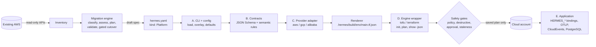

# Hermes Cloud Foundation

Describe your infrastructure once in a cloud-independent spec (`hermes.yaml`). Deploy it to **AWS**,
**Google Cloud** or **Alibaba Cloud** through OpenTofu or Terraform, behind explicit safety gates. Then plan a
**Terraform-independent migration** off an existing AWS estate: discover, assess, plan, validate, and cut over
behind gates.

> **Project status: v0.1 (`hermes/v1alpha1`), mock-tested only. Nothing has been deployed to a real cloud
> account.** Every provider composition is exercised with `tofu test` and mock providers. The CLI is tested
> with a fake engine. The register of what is and is not verified is [docs/limitations.md](docs/limitations.md).

## What Hermes is, and what it is not

| Hermes is | Hermes is not |
|---|---|
| A thin CLI that validates a portable spec, picks a provider composition, renders a root module and wraps the engine with safety gates ([ADR 0001](docs/decisions/0001-thin-cli-over-the-engine.md)) | An IaC engine. OpenTofu (default) or Terraform does all planning, applying, state and import work |
| A set of capability contracts with one composition per cloud ([ADR 0003](docs/decisions/0003-capability-contracts-and-provider-compositions.md)) | A universal cloud API. Differences between clouds are measured and reported, not hidden ([ADR 0015](docs/decisions/0015-measurable-portability.md)) |
| A read-only, agentless AWS discovery and migration-planning toolkit ([ADR 0009](docs/decisions/0009-agentless-read-only-discovery.md)) | A data mover. Managed services (DMS, Storage Transfer, and similar) move data, and Hermes plans and gates the steps ([ADR 0010](docs/decisions/0010-delegate-data-movement.md)) |
| Serverless containers (ECS Fargate, Cloud Run, SAE), managed PostgreSQL, object storage, pub/sub, secrets and telemetry | Kubernetes, MySQL or DNS management. These are reserved in the spec and rejected with `HCF111` |

## 60-second quickstart (offline, no cloud credentials needed)

Requires Go ≥ 1.24 and OpenTofu ≥ 1.10 (or Terraform ≥ 1.11). See [installation](docs/tutorials/installation.md).

```bash
go build -o bin/hermes ./cmd/hermes          # or `make build` with GNU Make >= 4.3
mkdir /tmp/hermes-demo && cd /tmp/hermes-demo
hermes init --name demo --provider aws --account 123456789012
hermes validate --env dev                    # schema + semantic + provider rules
hermes portability                           # score the spec against every provider
hermes render                                # writes .hermes/build/dev/main.tf.json
```

Real output of the last three commands (captured 2026-11-19, trimmed):

```text
$ hermes validate --env dev
environment dev (aws): valid

$ hermes portability
Portability of demo/dev (7 requested features)
PROVIDER  SCORE  IMPLEMENTED  PARTIAL  NOT-IMPLEMENTED  NOTES
alibaba   71.4   4            2        1
aws *     100.0  7            0        0
gcp       100.0  7            0        0                1 sizing/extension finding(s)

$ hermes render
Rendered /tmp/hermes-demo/.hermes/build/dev/main.tf.json (dev, aws, engine tofu)
  state   s3://demo-hermes-state/hermes/demo/dev/aws/terraform.tfstate
```

`hermes plan` and `hermes apply` contact the cloud with your credentials. Plan saves a reviewed plan, and apply
refuses anything else. The [quickstart tutorial](docs/tutorials/quickstart.md) walks through every step and the
gates.

## Feature status

Labels follow [CLAUDE.md](CLAUDE.md) rule 5. "Verified" always means verified **offline** (Go tests, `tofu test`
with mock providers, conftest fixtures). It never means verified on a real cloud.

| Area | Status | Evidence |
|---|---|---|
| Spec loading, overlays, JSON Schema + semantic validation | implemented & verified (offline) | `go test ./internal/config ./internal/schema` |
| Provider adapters: regions, sizing, extension keys, capability matrices | implemented & verified (offline) | `go test ./internal/providers` |
| Portability scoring | implemented & verified (offline) | `go test ./internal/providers`; scores reflect the mock-tested modules |
| Rendering JSON root modules with embedded, digest-locked modules | implemented & verified (offline) | golden tests; `make integration` ran `tofu init -backend=false` + `validate` on 10 example environments |
| Saved-plan apply, destructive and approval gates, policy gate, history | implemented & verified with a fake engine; **not tested against a real cloud** | `go test ./internal/execution ./internal/cli` |
| AWS composition (ECS Fargate, RDS, S3, SNS+SQS, Secrets Manager, CloudWatch, ADOT) | implemented, **not tested against a real cloud** | composition 11/11 `tofu test` runs; 58/58 across the AWS composition, modules and bootstrap (mock providers, 2026-11-21) |
| GCP composition (Cloud Run, Cloud SQL, GCS, Pub/Sub, Secret Manager, Cloud Logging/Monitoring/Trace) | implemented, **not tested against a real cloud** | composition 17/17 `tofu test` runs; 47/47 across the GCP composition, modules and bootstrap (mock providers, 2026-11-21) |
| Alibaba composition (SAE, ApsaraDB RDS, OSS, MNS, KMS, SLS) | implemented, **not tested against a real cloud**; several features partial or manual | composition 12/12 `tofu test` runs; 39/39 across the Alibaba composition, modules and bootstrap (mock providers, 2026-11-21) |
| State bootstrap (S3 / GCS / OSS + Tablestore) and CI OIDC identities | implemented, **not tested against a real cloud** | module `tofu test` runs (mock providers) |
| Plan policies (Conftest/Rego, all three providers) | implemented & verified against synthetic plans and plans derived from the compositions (mock providers) | `make policy-test`: 41/41 Rego tests (2026-11-21) |
| `hermes cost` (Infracost wrapper) | implemented, not tested (Infracost not run); Alibaba **not supported** by Infracost | — |
| `hermes status --drift` | implemented, **not tested against a real cloud** | fake engine only |
| AWS discovery (`hermes inventory aws`), read-only guard, IAM policy | implemented & verified with Go fakes and a local moto server; **not run against real AWS** | `go test ./internal/inventory/...`. The moto demo discovered 58 resources of 28 types, and all 81 API operations called were on the allowlist. An opt-in real-AWS test exists and has never run |
| Migration assess / plan / generate / validate / cutover (to GCP or Alibaba) | implemented & verified offline on a sample inventory; cutover hooks never run against real systems | `go test ./internal/migration/...`; sample run below |
| IaC adoption (`hermes adopt`, import-only gate) | implemented & verified with a fake engine; **not tested against real AWS** | `go test ./internal/migration/adopt` |
| GCP or Alibaba as a migration **source** | not supported | AWS is the only source |
| Kubernetes compute, MySQL, DNS | designed, not implemented (reserved; `HCF111`) | — |

## Architecture



Layers A to E and the migration engine are explained in the
[architecture overview](docs/architecture/overview.md). Package-level design and sequence diagrams are in the
[detailed design](docs/architecture/detailed-design.md).

## Provider coverage (summary)

Values come from `hermes providers`, which reads the Go capability matrices (21 features). The full table with
notes is [docs/providers/comparison-matrix.md](docs/providers/comparison-matrix.md).

| | AWS | GCP | Alibaba Cloud |
|---|---|---|---|
| implemented | 19 | 20 | 11 |
| partial | 2 (scale to zero, PostGIS) | 1 (PostGIS) | 5 (PostGIS, PITR, alerts, tracing, per-service identity) |
| not implemented | 0 | 0 | 5 (scale to zero, OTel sidecar, DB IAM auth, secret injection, client-side state encryption) |
| Real-cloud testing | none | none | none |

PostGIS is partial everywhere: the extension is available, but `CREATE EXTENSION` is a manual post-provision
step.

## Migration overview

Migration is a separate workflow from provisioning ([lifecycle](docs/migration/migration-lifecycle.md)):

1. `hermes inventory aws` performs agentless, read-only discovery through an assumed role with an ExternalId. An
   operation allowlist is enforced before any request is sent, and permission gaps are recorded, not hidden.
2. `hermes migrate assess --target gcp|alibaba` classifies resources against the
   [service catalog](docs/migration/service-mapping.md) and reports blockers, waves and an indicative transfer
   cost range.
3. `hermes migrate generate` writes a **draft** target `hermes.yaml`, plus `MAPPING.md` and `UNSUPPORTED.md`.
4. `hermes migrate plan` builds an ordered plan with approval and validation gates.
5. `hermes migrate validate` runs the declared checks, and `hermes migrate cutover` (a dry run by default) runs
   only the hooks you declare, behind approvals. Decommissioning is never automated
   ([ADR 0014](docs/decisions/0014-cutover-hooks-and-no-automatic-decommission.md)).

Offline run on [`examples/migration/sample-inventory.json`](examples/migration/sample-inventory.json) (62
resources, 86 relationships, 4 gaps), captured 2026-11-20 (each command writes its document with `--out`):

```text
$ hermes migrate assess --inventory sample-inventory.json --target gcp --out assessment.json
Assessed 62 resource(s) for gcp: portability score 31.0%, 1 blocker(s), 7 risk(s), 4 discovery gap(s), 6 wave(s).
Data to migrate: 1953597383680 bytes required; indicative transfer cost USD 97.68-332.11 (range from pricing assumptions, not a quote).
$ hermes migrate generate --assessment assessment.json --out target
Wrote target/hermes.yaml, target/MAPPING.md, target/UNSUPPORTED.md (DRAFT — requires human review).
37 resource(s) mapped, 25 listed in UNSUPPORTED.md.
$ hermes migrate plan --assessment assessment.json --out migration-plan.yaml
Plan ebd525afd5cd: 218 step(s) in 8 phase(s); 132 approval gate(s), 20 validation gate(s), 61 step(s) touch the source.
```

Every command and its output is documented in [migration commands](docs/migration/migration-commands.md).
`hermes adopt` imports existing, hand-built resources into a separate source-adoption state with import-only
plans ([IaC adoption](docs/migration/iac-adoption.md)). Adoption is not migration.

## Safety model

- **No silent apply.** `apply` applies only the plan saved by `hermes plan`. It refuses when that plan is stale,
  expired (24 h by default), tampered with, or failed policy ([ADR 0007](docs/decisions/0007-saved-plan-apply-and-approval-gates.md)).
- **Destructive changes** (delete or replace) need `--allow-destructive`. **Protected environments** (default:
  `production`) need `--approve <plan-id-prefix>` (at least 8 characters), a remote state backend, and a policy
  check. `destroy` always needs approval.
- **No secrets in IaC.** Secret values never pass through the spec, state, outputs or discovery
  ([ADR 0012](docs/decisions/0012-secret-values-outside-iac.md)).
- **Discovery is read-only**, and a unit test enforces the operation allowlist.
- **Isolated state** for each project, environment and provider ([ADR 0008](docs/decisions/0008-state-isolation-and-backends.md)).
- Refusals exit with code 2 and are recorded in `.hermes/history/<env>.jsonl`. See the
  [diagnostic codes](docs/reference/diagnostics.md).

## Documentation map

| You want to… | Read |
|---|---|
| Understand the project in 5 minutes | [Executive overview](docs/overview/executive-overview.md) |
| Install and try it | [Installation](docs/tutorials/installation.md), [quickstart](docs/tutorials/quickstart.md), [multi-cloud](docs/tutorials/multi-cloud.md) |
| Contribute code | [Onboarding](docs/tutorials/onboarding.md), [testing guide](docs/testing.md), [CONTRIBUTING.md](CONTRIBUTING.md) |
| Look up commands, fields and codes | [CLI](docs/reference/cli.md), [configuration](docs/reference/configuration.md), [diagnostics](docs/reference/diagnostics.md) |
| Go to production | [First production environment](docs/tutorials/first-production-environment.md), [state management](docs/operations/state-management.md), [cost and sizing](docs/operations/cost-and-sizing.md) |
| Plan a migration | [Migration lifecycle](docs/migration/migration-lifecycle.md), [AWS to GCP](docs/migration/aws-to-gcp.md), [AWS to Alibaba](docs/migration/aws-to-alibaba.md) |
| Know what is not done | [Limitations register](docs/limitations.md) |
| Everything else | [Documentation index](docs/README.md) |

## Repository layout

```text
cmd/hermes, internal/      Go CLI (cli, config, schema, providers, render, execution, policy, state,
                           tfplan, inventory, graph, migration, diagnostics, ui)
schemas/                   JSON Schemas (platform, inventory, migration documents)
infra/contract/            the provider module contract (variables.tf, outputs.md)
infra/providers/<p>/       one composition per cloud
infra/modules/<p>/         per-cloud modules (naming, network, kms, container-service, postgres, ...)
infra/bootstrap/<p>/       state backend and CI identity roots
policies/                  Conftest/Rego plan policies and fixtures
migration/                 service catalog, workflows, pricing assumptions, runbooks, discovery policy
examples/                  example specs, see examples/README.md
docs/                      documentation, see docs/README.md
```

## License

[Apache License 2.0](LICENSE).
