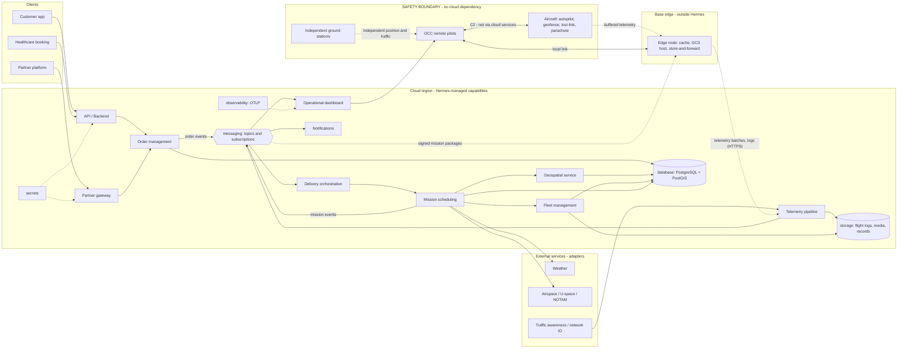
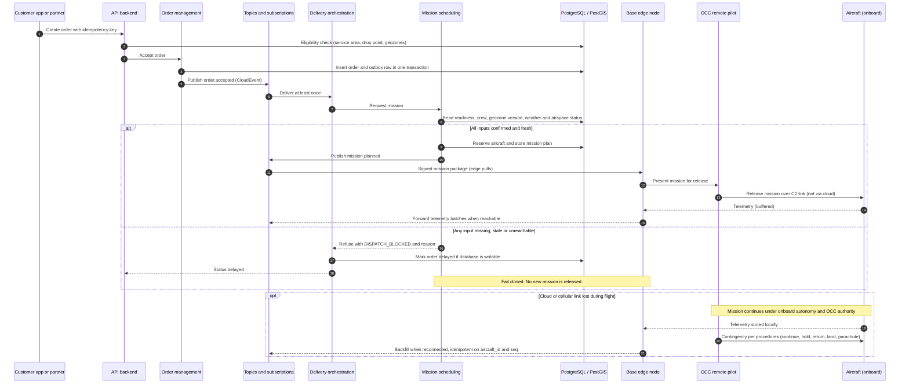

# Reference architecture: autonomous drone logistics on Hermes v1alpha1

Status: **designed, not implemented.** This is a reference design built on the Hermes v1alpha1
capabilities defined in [data-contracts.md](data-contracts.md). It does not claim that any
provider module, or the example spec below, has been tested against a real cloud. Implementation
status per capability is tracked in `docs/limitations.md` (the limitations register).

Subject: *a representative autonomous drone logistics operator*. Its workload is described in
[the workload analysis](../research/autonomous-logistics-workload-analysis.md). Throughput, size
and latency figures here are **assumptions** carried over from that note.

---

## 0. SAFETY BOUNDARY (read first)

> **Flight safety never depends on any cloud provider, on Hermes, or on anything Hermes deploys.**

The following are **outside** the cloud and outside Hermes, and must work with zero connectivity to
any cloud region:

- **Flight control and onboard autonomy**: autopilot, navigation, sense-and-avoid where fitted.
- **Geofencing**: onboard geozone and geocage enforcement using a locally stored, versioned
  dataset.
- **Emergency procedures**: lost-link behaviour, return-to-home or return-to-base, hold, divert,
  controlled or safe landing, flight termination, and **parachute** deployment, as defined in the
  operational authorisation.
- **Fallback operations**: the Operational Control Centre (OCC) and remote pilots keep authority
  over aircraft in flight through command-and-control (C2) and monitoring paths that do not
  transit cloud managed services. These include independent ground stations for traffic
  awareness and aircraft position, and documented manual procedures.
- **Direct (broadcast) remote ID** is onboard.

Design rules for everything on the cloud side:

1. **Cloud outage is an expected failure**, not an exceptional one. Every cloud component has a
   defined degraded mode (§7).
2. **Fail closed on dispatch.** No new mission is released unless order state, aircraft
   readiness, crew assignment, geozone version and airspace or authorisation status are
   confirmed **and fresh**. "Cannot confirm" means "do not dispatch".
3. **In-flight missions continue under onboard and OCC authority.** The cloud never commands an
   aircraft in flight and is never required to end a flight safely.
4. **Store-and-forward telemetry.** Aircraft and base edge nodes buffer telemetry and logs. Cloud
   ingest accepts late, duplicated and out-of-order data and records gaps explicitly.
5. **No cloud-held safety interlocks.** Cloud state may *inform* the OCC (for example traffic
   overlays) but is never the only source for a safety decision.
6. **Changes to C2 or relay infrastructure** (VPN concentrators, link relays) are outside Hermes
   v1alpha1. They are never migrated during flight operations (see "Migration cutover" in §7).

---

## 1. Component diagram



Dotted lines are intermittent or store-and-forward paths. The `Safety` subgraph keeps working
when everything in `Cloud` and `Ext` is unavailable.

---

## 2. Components

| Component | Responsibilities | Infra needs | Hermes capability |
|---|---|---|---|
| **Customer app** (client) | Address sign-up, ordering, tracking, delivery confirmation | Calls the public API. Push notifications. | n/a (client). Talks to `compute` (public service). |
| **API / Backend** | AuthN/Z, order API, idempotency keys, eligibility checks, ETA queries | Public HTTPS, autoscaling (meal-time peaks), `min_instances ≥ 2` in production | `compute` (public), `database`, `secrets`, `observability` |
| **Partner gateway** | Inbound partner orders (webhooks or API), outbound status callbacks, per-partner auth | Public HTTPS, a stable egress IP for partner allow-lists (via NAT), per-partner secrets | `compute` (public), `network` (`nat: true`), `secrets`, `messaging` (publish) |
| **Order management** | Order lifecycle (accepted → planned → in-flight → delivered/failed/cancelled), status history, refunds and compensation hooks | Transactions, unique constraints, outbox table for reliable event publish | `database`, `messaging` (publish) |
| **Delivery orchestration** | State machine joining orders and missions, retries, timeouts, compensation, a healthcare chain-of-custody event log | Durable at-least-once events, dead-letter, idempotent handlers | `compute` (private), `messaging` (consume and publish), `database` |
| **Mission scheduling** | Aircraft, base and crew assignment; route and energy plan; weather and airspace go/no-go; **fail-closed dispatch gate**; signed mission package for the edge | CPU bursts, consistent reads, freshness checks on every input, external adapter calls with timeouts | `compute` (private), `database`, `messaging`, `secrets` (adapter credentials) |
| **Geospatial** | Service areas, drop points, geozones (versioned), route corridors, conformance checks after flight | PostGIS with GiST indexes, geozone versions pinned per mission | `database` (`extensions: [postgis]`) |
| **Fleet management** | Aircraft registry, readiness, maintenance and airworthiness records, firmware versions, battery cycles | Relational records, attachments (maintenance photos and reports) | `database`, `storage` |
| **Telemetry pipeline** | HTTPS batch ingest from base edge nodes, deduplication (`aircraft_id`+`seq`), freshness tracking, hot store, archive of raw batches and flight logs, ingest of external traffic feeds | Bursty ingest, idempotent writes, partitioned tables, object storage for raw data | `compute`, `messaging`, `database`, `storage`. The device-facing MQTT broker is **out of scope** (§4). |
| **Notifications** | Customer ETA, delivery and exception messages; partner callbacks; OCC alerts fan-out | Fan-out, retries, dead-letter, provider API keys | `messaging`, `compute`, `secrets` |
| **Operational dashboard** | Real-time fleet map, mission states, telemetry freshness, traffic overlay, dispatch-gate status, alerts for the OCC | Push to browsers (WebSocket or SSE), SSO in front, read replicas or caches | `compute` (private, `public: false`; reached through an identity-aware proxy / SSO, never exposed without authentication), `messaging` (consume), `database`, `observability` |

The OCC console used for **flight supervision** is part of the safety boundary. It must also work
from the base edge or the ground-station path, so the cloud dashboard is an *additional* view.

---

## 3. Example `hermes.yaml` (illustrative)

> Illustrative only. It was written against the v1alpha1 contract in
> [data-contracts.md §1](data-contracts.md) but **not validated** with `hermes validate` in this
> repository snapshot. The image references are placeholders.

```yaml
apiVersion: hermes/v1alpha1
kind: Platform

project:
  name: drone-logistics
  environment: dev
  owner: platform-team
  protected_environments: [production]

cloud:
  provider: aws                      # aws | gcp | alibaba; the spec below is otherwise unchanged
  region: eu-north-1                 # pick an EU region for data residency
  account: "123456789012"

state:
  backend: auto
  bucket: example-hermes-state

network: {cidr: 10.20.0.0/16, zones: 3, nat: true}

workloads:
  compute:
    type: containerized
    services:
      - name: api
        image: ghcr.io/example/logistics-api:1.0.0
        port: 8080
        cpu: 0.5
        memory_mb: 1024
        min_instances: 2
        max_instances: 10
        public: true
        health_check_path: /healthz
        secret_env: {PAYMENT_API_KEY: payment-api-key}
        access: {publish: [orders], database: true}
      - name: partner-gw
        image: ghcr.io/example/partner-gateway:1.0.0
        port: 8080
        cpu: 0.5
        memory_mb: 1024
        min_instances: 1
        max_instances: 5
        public: true
        health_check_path: /healthz
        secret_env: {PARTNER_WEBHOOK_KEY: partner-webhook-key}
        access: {publish: [orders], consume: [notify-partner], database: true}
      - name: orchestrator
        image: ghcr.io/example/orchestrator:1.0.0
        port: 8080
        cpu: 0.5
        memory_mb: 1024
        min_instances: 1
        max_instances: 4
        health_check_path: /healthz
        access: {consume: [orders-orchestrator, missions-workflow], publish: [missions, notifications], database: true}
      - name: scheduler
        image: ghcr.io/example/mission-scheduler:1.0.0
        port: 8080
        cpu: 1
        memory_mb: 2048
        min_instances: 1
        max_instances: 4
        health_check_path: /healthz
        secret_env: {WEATHER_API_KEY: weather-api-key, AIRSPACE_CLIENT_KEY: airspace-client-key}
        access: {consume: [missions-scheduler], publish: [missions], database: true}
      - name: fleet
        image: ghcr.io/example/fleet:1.0.0
        port: 8080
        cpu: 0.25
        memory_mb: 512
        min_instances: 1
        max_instances: 2
        health_check_path: /healthz
        access: {buckets: {media: read-write, records: read-write}, database: true}
      - name: telemetry-ingest
        image: ghcr.io/example/telemetry-ingest:1.0.0
        port: 8080
        cpu: 0.5
        memory_mb: 1024
        min_instances: 2             # warm: edge nodes backfill in bursts after reconnect
        max_instances: 10
        public: true                 # edge nodes push HTTPS batches; authenticate per edge node
        health_check_path: /healthz
        secret_env: {TRAFFIC_FEED_KEY: traffic-feed-key}
        access: {publish: [telemetry], buckets: {flight-logs: read-write}}
      - name: telemetry-writer
        image: ghcr.io/example/telemetry-writer:1.0.0
        port: 8080
        cpu: 0.5
        memory_mb: 1024
        min_instances: 1
        max_instances: 6
        health_check_path: /healthz
        access: {consume: [telemetry-store], database: true}
      - name: notify
        image: ghcr.io/example/notify:1.0.0
        port: 8080
        cpu: 0.25
        memory_mb: 512
        min_instances: 0
        max_instances: 4
        health_check_path: /healthz
        secret_env: {PUSH_CREDENTIALS: push-credentials}
        access: {consume: [notifications-push]}
      - name: ops-dashboard
        image: ghcr.io/example/ops-dashboard:1.0.0
        port: 8080
        cpu: 0.5
        memory_mb: 1024
        min_instances: 1
        max_instances: 3
        public: false                # operator UI: reach it through an identity-aware proxy / SSO
        health_check_path: /healthz
        access: {consume: [telemetry-dashboard, missions-dashboard], database: true}

  database:
    enabled: true
    engine: postgresql
    version: "16"
    size: medium
    storage_gb: 100
    max_storage_gb: 500
    high_availability: true
    backup_retention_days: 35
    point_in_time_recovery: true
    extensions: [postgis]            # NOT timescaledb: not portable across the three providers (§5.2)

  storage:
    enabled: true
    buckets:
      - {name: flight-logs, versioning: true, retention_days: 0}
      - {name: media, versioning: true, retention_days: 180}
      - {name: records, versioning: true, retention_days: 0}   # immutability lock: out of scope (§4)

  messaging:
    enabled: true
    topics:
      - name: orders
        retention_hours: 168
        subscriptions:
          - {name: orders-orchestrator, ack_deadline_seconds: 60, max_delivery_attempts: 5}
      - name: missions
        retention_hours: 168
        subscriptions:
          - {name: missions-scheduler, ack_deadline_seconds: 120, max_delivery_attempts: 5}
          - {name: missions-workflow, ack_deadline_seconds: 60, max_delivery_attempts: 5}
          - {name: missions-dashboard, ack_deadline_seconds: 10, max_delivery_attempts: 0}
      - name: telemetry
        retention_hours: 24
        subscriptions:
          - {name: telemetry-store, ack_deadline_seconds: 30, max_delivery_attempts: 10}
          - {name: telemetry-dashboard, ack_deadline_seconds: 10, max_delivery_attempts: 0}
      - name: notifications
        retention_hours: 72
        subscriptions:
          - {name: notifications-push, ack_deadline_seconds: 30, max_delivery_attempts: 5}
          - {name: notify-partner, ack_deadline_seconds: 30, max_delivery_attempts: 8}

  secrets:
    enabled: true
    names: [payment-api-key, partner-webhook-key, weather-api-key, airspace-client-key,
            traffic-feed-key, push-credentials]

  observability:
    enabled: true
    log_retention_days: 90
    metrics: true
    tracing: true

environments:
  production:
    workloads: {database: {size: large}}
```

Notes:

- Control-plane events (orders, missions) and telemetry use **separate topics**, so a telemetry
  backlog can never delay dispatch-related events.
- Dashboard subscriptions use `max_delivery_attempts: 0` (no dead-letter), because stale
  real-time data is worthless once superseded.

---

## 4. Out of scope for v1alpha1, with recommended options

| Need | Why it is out of scope | Recommended options |
|---|---|---|
| **Device-facing MQTT broker** | v1alpha1 `compute` models HTTP services with public HTTPS ingress only. MQTT needs long-lived TCP/TLS sessions (typically port 8883), broker state and device identity. | **Preferred portable pattern:** aircraft talk to the **base edge node** locally (MAVLink or a local MQTT broker), and the edge node pushes **HTTPS batches** to `telemetry-ingest`. This keeps everything inside v1alpha1. If a cloud broker is required: AWS IoT Core (managed MQTT); Alibaba Cloud IoT Platform (MQTT); on GCP there has been **no first-party managed MQTT service since Cloud IoT Core retired on 16 Aug 2023**, so use a self-managed broker (for example Eclipse Mosquitto, EMQX, VerneMQ) or a partner service. Managed brokers are not portable, so put a broker-agnostic MQTT 5.0 client and topic scheme in front of them. |
| **C2 link relays / VPN concentrators** | Non-HTTP, stateful, on the safety-relevant path | Keep outside Hermes, with an independent path. Never migrate during flight operations. |
| **Dedicated time-series database** | No `timeseries` capability in v1alpha1, and extension support differs per provider (§5.2) | Use PostgreSQL native partitioning first. Later: self-managed TimescaleDB, a vendor-managed TimescaleDB service, or a provider-native time-series service, each a deliberate portability trade-off. |
| **Kubernetes** | `compute.type: kubernetes` is **reserved** (validation error "not implemented") | Use EKS, GKE or ACK out-of-band if you need self-hosted brokers, stream processors or GPU workloads. Keep the Hermes-managed services on `containerized`. |
| **Immutable (WORM) object retention** | Not in the `storage` contract (only `versioning` and `retention_days` expiry) | Configure provider retention locks out-of-band, or as a future `extensions.<provider>` field: S3 Object Lock, GCS Bucket Lock / retention policies, OSS retention policies. Also keep a hash manifest in the database. |
| **Cross-region DR** | Single `cloud.region` per spec | A second Hermes environment in another region, with documented, *manual*, gated failover. Cross-region replicas configured out-of-band. |
| **DNS** | `dns.enabled: true` is reserved | Manage DNS out-of-band with low TTLs and health-checked records. See the DNS failure row in §7. |
| **SSO / identity-aware proxy** for the dashboard | Not modelled | Provider extension, or the identity provider in front of `ops-dashboard`. |

---

## 5. Analysis

### 5.1 PostGIS (portable: yes)

- **Support:**
  - Amazon RDS for PostgreSQL lists PostGIS (for example 3.4.x on PostgreSQL 16 and 3.5.x on 17
    in the release-notes tables)
  - Cloud SQL supports PostGIS "for all major versions"
  - ApsaraDB RDS for PostgreSQL lists PostGIS 3.3.x for PostgreSQL 10–18

  Versions differ per provider, so pin a **minimum common PostGIS version** in tests and avoid
  functions newer than it.
- **Modelling:**
  - store geometries in SRID 4326
  - use `geography` (or a projected SRID) for metre-accurate distances
  - put GiST indexes on service areas, geozones and drop points
  - use `ST_DWithin` and `ST_Intersects` for eligibility and corridor checks
  - keep geozones **versioned** (`valid_from`, `valid_to`, `source`, `version`) and record the
    version used by each mission (regulatory evidence)
- **Hot path:** keep telemetry rows as plain numeric lat/lon/alt plus timestamps. Build geometries
  for conformance analysis after the flight, or in batch, not per message.

### 5.2 Time-series data (portable: only with plain PostgreSQL)

| Option | AWS | GCP | Alibaba Cloud |
|---|---|---|---|
| TimescaleDB extension in the managed PostgreSQL | **Not listed** in the RDS for PostgreSQL extension tables reviewed (PostgreSQL 16–19) | **Not listed** in Cloud SQL supported extensions | **Supported, Apache-licensed edition only**; gated features return "not supported under the current license" |
| Native managed time-series service | Timestream for LiveAnalytics is **closed to new customers since 20 Jun 2025**. Other services exist (for example Timestream for InfluxDB) but were not evaluated. | Provider services exist but were not evaluated | Provider services exist but were not evaluated |
| PostgreSQL native partitioning + `pg_partman` / `pg_cron` | `pg_partman` and `pg_cron` listed | `pg_partman` and `pg_cron` listed | `pg_partman` and `pg_cron` listed |

- **Trade-off:** TimescaleDB on ApsaraDB is the Apache edition, which lacks columnstore
  compression, continuous aggregates, retention policies and the job scheduler (those are
  Community/TSL features). So even where it is available, it gives little beyond hypertables
  compared with plain partitioning.
- **Recommendation for v1alpha1:**
  - **range-partition telemetry by day** (or by hour at the enterprise tier) with `pg_partman`
  - drop or detach old partitions on schedule after archiving raw batches to `flight-logs`
  - keep downsampled per-flight summaries in a normal table

  This is portable across all three providers. A spec listing `timescaledb` in
  `database.extensions` is not portable: per the contract, the adapter validates extension
  support, so expect it to be rejected on GCP and AWS.

### 5.3 High-volume events

- Volumes are modest (assumption: up to about 3,500 telemetry msgs/s at the enterprise upper
  bound). Batch anyway: one message per aircraft per 1–5 s carrying several samples.
- Use the **CloudEvents** envelope (`id`, `source`, `type`, `time`, `subject`=aircraft or
  mission). Consumers deduplicate on `source`+`id`, and telemetry also on `aircraft_id`+`seq`.
- Keep payloads small. Large items (logs, images) go to object storage, and the event carries a
  reference plus a checksum (claim-check pattern). Message size limits differ per provider, so
  check each limit and keep a conservative common ceiling.
- **Ordering is not guaranteed** across SNS+SQS (standard), Pub/Sub (without ordering keys) or
  MNS. Never rely on delivery order. Use the device-side `seq` and `ts`.

### 5.4 Queues

- Delivery is at-least-once everywhere, so every handler must be idempotent. Keep a processed-ID
  table or use upserts.
- Orders are written to the database **and** published through an **outbox** table, so a
  messaging outage never loses an accepted order.
- `max_delivery_attempts` sends poison messages to dead-letter. Alert on dead-letter depth and on
  the **age of the oldest message** per subscription.
- `retention_hours` (≤336) bounds how long the system can be partitioned before data is lost from
  the bus. Raw telemetry is also archived to object storage at ingest, so the bus is never the
  only copy.

### 5.5 Object storage (images, flight logs, records)

- Buckets:
  - `flight-logs`: raw telemetry batches and full-rate onboard logs
  - `media`: proof-of-delivery images and maintenance photos, with lifecycle expiry
  - `records`: the regulatory archive, kept indefinitely
- **Uploads:**
  - edge nodes upload logs through short-lived signed URLs issued by `telemetry-ingest`
  - every object has a SHA-256 checksum recorded in the database
  - the mission record links to the object key
- **Records:**
  - versioning on
  - an out-of-band retention lock (§4)
  - access logging
  - periodic restore tests
  - customer-managed keys in protected environments (the default per the contract)
- Retention follows the record-keeping duty in the workload analysis (UAS.SPEC.050; 3-year
  figure verified in UK CAA AMC, not confirmed in the EU consolidated text).

### 5.6 Database availability

- `high_availability: true` maps to the provider's synchronous standby (multi-AZ / regional HA /
  high-availability edition). Failover still drops connections for **tens of seconds to minutes**
  (assumption; measure per provider).
- Applications retry with jittered backoff and bounded timeouts. During failover the scheduler
  **cannot confirm state, so it does not dispatch** (§7).
- PITR is bounded by `backup_retention_days` (≤35). It is a recovery tool, **not** a records
  archive.
- Plan for connection pooling, since many small container instances can exhaust connections.

### 5.7 Real-time monitoring

- OTLP via the injected collector goes to the native backends. Key SLIs:
  - **telemetry freshness** per aircraft (now − last device `ts`)
  - dispatch-gate state (open or closed, and why)
  - end-to-end order→dispatch latency
  - subscription oldest-message age and dead-letter depth
  - database replication lag and failover events
  - external adapter error rates and latency (weather, airspace, traffic)
  - edge-node last-sync time
- The OCC dashboard uses WebSockets or SSE. On Cloud Run, WebSockets are supported but bound by
  the request timeout (max 60 min), with best-effort affinity, so clients must reconnect and
  state must live outside the instance. Verify equivalent behaviour on the other providers'
  ingress.
- Alerts that matter to flight safety go to the OCC through **its own** channels too, not only
  cloud alerting.

### 5.8 Intermittent connectivity, edge and offline

- Aircraft to edge to cloud is **store-and-forward** at each hop. Ingest is idempotent and accepts
  out-of-order data, and gaps are recorded explicitly (see workload analysis §6).
- Each base edge node caches the active mission set, geozones, readiness and crew roster. It can
  complete and recover in-flight missions offline. It **cannot release new missions** without
  fresh, confirmed cloud state, unless a documented manual procedure under OCC authority applies.
- Offline crew tools sync later with explicit conflict rules. The customer API pauses or queues
  intake rather than accepting orders it cannot dispatch.

---

## 6. Mission dispatch with degraded-cloud handling



---

## 7. Failure modes

| Failure | Detection | Cloud-side behaviour | Flight-side behaviour | Recovery |
|---|---|---|---|---|
| **Region outage** | Provider health, synthetic probes, edge-node sync failures | Order intake unavailable or paused. **No dispatch.** Dashboards unavailable. | In-flight missions continue under onboard and OCC authority. The OCC uses the edge and independent ground-station views. | Manual, gated failover to a second-region environment if one exists. Otherwise wait. Backfill telemetry after recovery. |
| **Database failover** | Connection errors, provider failover event, replication-lag alarms | Retries with backoff. The scheduler treats the database as unconfirmed, so **dispatch is blocked** until reads and writes are healthy. Outbox events publish after recovery. | Unaffected | Automatic HA failover, then verify consistency. Release held orders through normal scheduling, not in bulk. |
| **Queue backlog** | Oldest-message age, subscription depth, dead-letter depth | Telemetry backlog is isolated on its own topic. If **control-plane** backlog exceeds a freshness threshold, dispatch is blocked. Scale consumers. | Unaffected | Drain, inspect dead-letter, replay idempotently. Raise retention only if within limits (≤336 h). |
| **Telemetry loss** (cellular gap or ingest failure) | Per-aircraft freshness SLI, sequence gaps | Mark the aircraft "stale" on dashboards and record the gap. Never infer position silently. | OCC uses the independent ground stations. Onboard lost-link procedures apply per the authorisation. | Store-and-forward backfill. Reconcile with the post-flight log, closing the gap record with the source noted. |
| **DNS failure** | Resolver errors in clients and edge nodes, synthetic checks | API and dashboard unreachable by name, and external adapters may fail. **No dispatch** if inputs cannot be refreshed. | Unaffected. Flight-critical paths must not need public DNS at runtime. | Out-of-band DNS (not managed by Hermes v1alpha1) with low TTLs. Edge nodes cache endpoints or use a secondary resolver. |
| **Credential expiry** (partner, weather, airspace, push, edge-node certificates) | Expiry monitoring before expiry, 401/403 rate alarms | The affected adapter's circuit opens. If airspace or weather inputs are affected, **dispatch is blocked**. Partner callbacks queue up. | Unaffected | Rotate through `secrets` (values set out-of-band). Alert well before expiry. Never embed long-lived credentials on aircraft. |
| **Migration cutover in progress** | Change calendar, cutover runbook state | Freeze dispatch during the cutover window, or cut over **outside flight hours**. Dual-write or replicate the database per the migration plan. Edge nodes point at one authoritative endpoint at a time. | No aircraft in flight during cutover of any component on the mission path. C2 and relay infrastructure are never part of a Hermes cutover. | Gated cutover with `--approve` and rollback per the `MigrationPlan`. Validation checks before reopening dispatch. |
| **External adapter outage** (weather, airspace/U-space, traffic feed) | Adapter error rate and latency SLIs | Circuit breaker opens. A missing **required** input blocks dispatch. A missing advisory input is flagged on the dashboard. | Unaffected. Airborne traffic awareness relies on onboard and independent ground-station sources. | Automatic once healthy. Record the outage window in operational records. |

---

## 8. Cost tiers (qualitative)

Use `PricingAssumptions` and provider calculators for numbers. Nothing below is a price.

| Tier (assumption) | Shape | Main cost drivers |
|---|---|---|
| **Small** (1–2 bases, ≤100 flights/day) | `zones: 2`, `database.size: small` (HA only in production), most services `min_instances: 1`, `notify` can scale to zero, log retention 30 days | NAT gateways per zone, HA database, log ingestion. Object storage is small. |
| **Medium** (3–10 bases, ≤1,000 flights/day) | `zones: 3`, `database.size: medium`/`large` with HA, `min_instances: 2` on ingest and API, daily telemetry partitions | HA database, flight-log storage growth, log and trace volume (sample traces) |
| **Enterprise** (10+ bases, multi-country) | Separate environments per jurisdiction or region, `database.size: xlarge`, hourly partitions, cross-region DR environment (out-of-band replication), dedicated broker or time-series cluster (out of scope for v1alpha1) | Multi-region duplication, archive storage (multi-year records), egress for any video, observability volume |

---

## References

- Hermes contracts: [data-contracts.md](data-contracts.md), `infra/contract/outputs.md`
- Workload analysis: [autonomous-logistics-workload-analysis.md](../research/autonomous-logistics-workload-analysis.md)
- Regulation (EU) 2019/947: https://eur-lex.europa.eu/eli/reg_impl/2019/947/oj
- Regulation (EU) 2021/664 (U-space): https://eur-lex.europa.eu/eli/reg_impl/2021/664/oj
- EASA ED Decision 2025/018/R (SORA 2.5): https://www.easa.europa.eu/en/document-library/agency-decisions/ed-decision-2025018r
- EASA FAQ, specific-category operator responsibilities: https://www.easa.europa.eu/en/faq/119232
- UK CAA AMC1 UAS.SPEC.050(1)(g): https://regulatorylibrary.caa.co.uk/2019-947/Content/AMC-GM/AMC1%20UAS%20SPEC%20050%201%20g%20Responsibilities.htm
- PostGIS documentation: https://postgis.net/documentation/
- Amazon RDS for PostgreSQL extension versions: https://docs.aws.amazon.com/AmazonRDS/latest/PostgreSQLReleaseNotes/postgresql-extensions.html
- Cloud SQL for PostgreSQL extensions: https://docs.cloud.google.com/sql/docs/postgres/extensions
- ApsaraDB RDS for PostgreSQL extensions: https://www.alibabacloud.com/help/en/rds/apsaradb-rds-for-postgresql/extensions-supported-by-apsaradb-rds-for-postgresql
- ApsaraDB RDS for PostgreSQL TimescaleDB (Apache edition only): https://www.alibabacloud.com/help/en/rds/apsaradb-rds-for-postgresql/use-the-timescaledb-extension
- TimescaleDB editions (Apache 2 vs Community): https://www.tigerdata.com/docs/about/latest/timescaledb-editions
- Amazon Timestream for LiveAnalytics availability change: https://docs.aws.amazon.com/timestream/latest/developerguide/AmazonTimestreamForLiveAnalytics-availability-change.html
- Cloud Run WebSockets: https://docs.cloud.google.com/run/docs/triggering/websockets
- OpenTelemetry OTLP specification: https://opentelemetry.io/docs/specs/otlp/
- CloudEvents: https://cloudevents.io/
- MQTT 5.0 (OASIS): https://docs.oasis-open.org/mqtt/mqtt/v5.0/mqtt-v5.0.html
- MAVLink: https://mavlink.io/en/
