# Detailed design

Package-by-package design of the `hermes` CLI, the data flow from spec to rendered root, the safety-gate state
machine, the provider adapter and composition model, the migration engine internals, and sequence diagrams for
the main flows. Read the [architecture overview](overview.md) first.

Everything here is derived from the code in this repository. Behaviour that involves a real cloud is
**implemented, not tested against a real cloud** ([limitations](../limitations.md)).

## 1. Packages

| Package | Responsibility | Key types and functions | Depends on |
|---|---|---|---|
| `cmd/hermes` | Entry point; build info via `-ldflags` | `main` → `cli.Execute` | `cli` |
| `internal/cli` | cobra commands. Each command group calls `Register` from its own `init()`, so command files never edit a shared list. Maps errors to exit codes (`ExitError`, `GateError` → 2) | `App` (global flags plus injectable hooks: `DetectEngine`, `Getenv`, `LookPath`, `Now`, `RunTool`), `load()` → `loaded{doc, p, adapter, diags}`, `makePlan`, `applySaved` | everything below |
| `internal/config` | Parse YAML (yaml.v3, keeping line numbers), validate against the embedded schema, overlay one environment, apply defaults and protected rules, run semantic rules | `Document`, `Load`/`Parse`, `Document.Resolve(env)` → `*Platform`, `Validate`, codes `HCF100`–`HCF120` | `schema`, `diag`, `schemas` |
| `internal/schema` | JSON Schema 2020-12 (santhosh-tekuri/jsonschema/v6) → diagnostics with dotted paths | `HCF101` | `schemas` |
| `internal/diag` | Diagnostic model shared by every layer | `Diagnostic{Severity, Code, Path, File, Line, Message, Hint}`, `Diagnostics` | — |
| `internal/providers` | The Go side of each provider: capability matrix, regions, extension keys, workload and plan rules, provider blocks, pins | `Adapter`, `CapabilityMatrix`, `Feature`, `Status` (weight 1 / 0.5 / 0), `Requested(p)`, `Portability(p)` → `Report`, `PinAWS`… | `config`, `diag` |
| `internal/render` | Normalized `Platform` → deterministic JSON root module; extract the embedded modules with a digest manifest; bootstrap roots | `Render`, `Build` (no write; used by apply to detect staleness), `ExtractModules`, `DigestFS`, `ErrModulesChanged`, `RenderBootstrap` | `providers`, `state`, `infra` (embed) |
| `internal/state` | Backend configuration and the OpenTofu `terraform.encryption` block | `ForPlatform`, `Key` (`<prefix>/<project>/<env>/<provider>/terraform.tfstate`), `Encryption` | `config` |
| `internal/execution` | Run the engine binary; create and apply saved plans behind gates; history | `Engine` (`Init`, `Plan`, `PlanRefreshOnly`, `ShowJSON`, `OutputJSON`, `ApplySaved`), `Detect`, `CreatePlan`, `LoadPlan`, `CheckApply`, `Apply`, `PlanMeta`, `HistoryEvent`, codes `HCF501`–`HCF512` | `tfplan` |
| `internal/execution/enginetest` | Fake engine for tests: records invocations, writes plan files, returns canned JSON. It never executes a binary | — | — |
| `internal/tfplan` | The subset of the JSON plan format used by gates and adoption; classifies changes | `Parse`, `Summarize`, `Summary.Destructive()`, `NonImportChanges()` | — |
| `internal/policy` | Run conftest on `plan.json` with embedded or explicit policies; pass `data.hermes.*` via `--data` | `Check` → `PolicyRecord`, codes `HCF301`–`HCF305` | `execution`, `render`, `policies` |
| `internal/diagnostics` | `hermes doctor`: engine version, tools, credential-source names, spec, `.gitignore`, disk. No cloud calls | `LowDiskBytes` (5 GiB) | `config`, `execution` |
| `internal/inventory` | Provider-neutral `Inventory` (data-contracts §3): normalization, digests, redaction, `managed_by` annotation from Terraform state or CloudFormation, AWS Config importer | `Inventory`, `Resource`, `Relationship`, `Gap` | — |
| `internal/inventory/aws` | Read-only AWS collectors (SDK v2) over an **operation registry**. A guard middleware rejects, before sending, any operation that is not registered, not read-named, or on the secret/data-read denylist. The IAM policy is generated from the same registry | `registry.go`, `guard.go`, `policy.go`, `collect_*.go`, `gaps.go` | `inventory` |
| `internal/graph` | Dependency graph; cycle-safe topological waves (SCCs collapsed); blast radius; Mermaid/DOT/JSON | `Wave` | `inventory` |
| `internal/migration` | Catalog classification, assessment, draft spec, plan, validation checks, gated cutover | `Assess`, `Assessment`, `Plan` (`ComputeID`), `ValidationReport`, `Controller` (cutover), codes `HCF401`–`HCF408` | `inventory`, `graph`, `migration` (embed) |
| `internal/migration/adopt` | Import blocks from an Inventory into a separate adoption workspace; import-only gate | `Generate`, `Plan`, `Verify`, `Apply`, `ErrNotImportOnly` | `inventory`, `tfplan` |
| `internal/ui` | Tables, JSON, diagnostic printing, terminal detection, y/N prompt | — | `diag` |

Embedded data: `infra/embed.go` (contract, compositions, modules, bootstrap), `schemas/embed.go`,
`policies/embed.go`, `migration/embed.go` (catalog, workflows, pricing). Every migration command accepts a file
override for its data.

## 2. Data flow: spec → rendered root

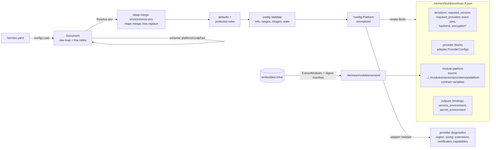

\* `terraform.encryption` is emitted only when the engine is OpenTofu and `state.encryption.client_side` is true
(AWS KMS or GCP KMS key provider, `aes_gcm`). It is rejected on Alibaba (`HCF208`).

Properties:

- **Deterministic.** Maps are encoded with sorted keys. The render digest is the SHA-256 of the rendered files.
  The modules digest (`DigestFS`) covers the extracted tree.
- **No silent module replacement.** An extracted modules directory that differs from the embedded set returns
  `ErrModulesChanged` unless `--refresh-modules` is given. At apply time, this surfaces as a stale plan (`HCF502`).
- **Relative module source.** It is computed between real paths (symlinks resolved), because the engine resolves
  sources from the real directory (for example, macOS `/var` → `/private/var`).
- **Only the selected provider's extensions are passed** to the composition (`extensions.<provider>`).

## 3. Safety-gate state machine

### Saved-plan lifecycle

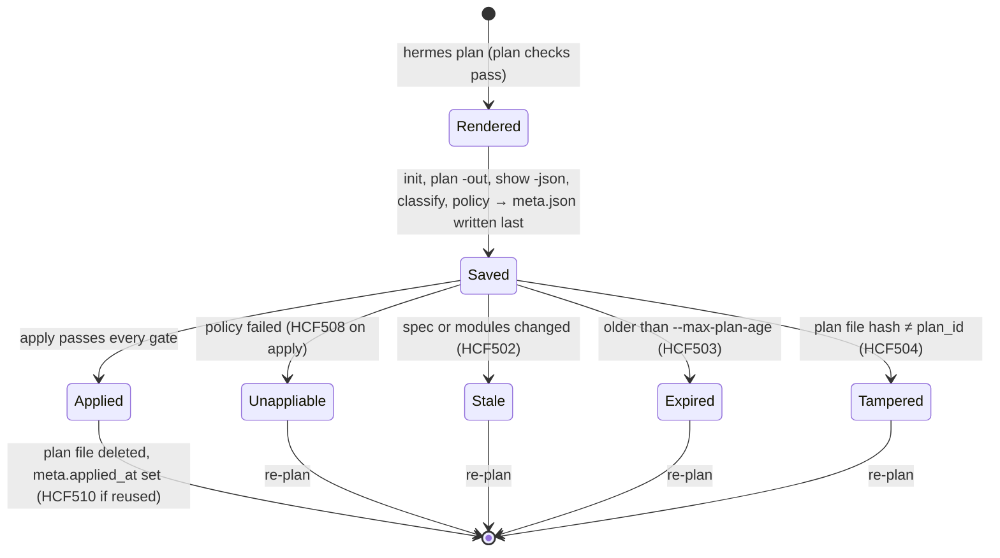

`meta.json` is written **last** (and removed first when a new plan starts), so an interrupted plan never looks
applicable.

### Apply and destroy gates (`execution.CheckApply`, evaluated in this order)

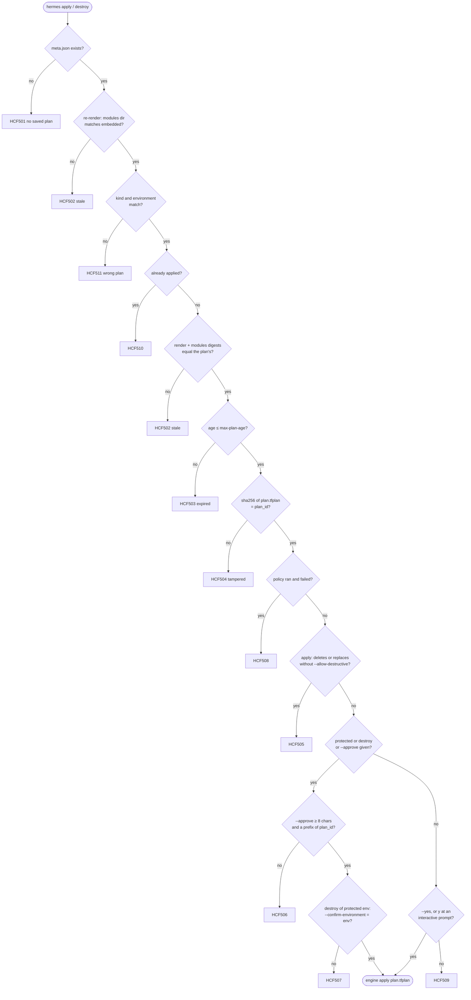

At plan time, a protected environment whose policy check cannot run (no conftest, no policies) is refused with
`HCF512`, unless `--skip-policy` is given, which is recorded. `--yes` is ignored in protected environments.
Every refusal and every apply is appended to `.hermes/history/<env>.jsonl`. Tests:
`internal/execution/gates_test.go`, `internal/cli/cli_test.go`.

## 4. Provider adapter and composition model

A provider has two halves that must agree ([ADR 0003](../decisions/0003-capability-contracts-and-provider-compositions.md)):

| Go adapter (`internal/providers/
.go`) | HCL composition (`infra/providers/
/platform`) |
|---|---|
| `Capabilities()`: 21 features with status and note | implements the features with `infra/modules/
/*` |
| `Regions()`, `ExtensionKeys()`, `Validate`, `CheckWorkloads` (sizing, DB extensions, capability warnings), `PlanChecks` | `variables.tf` copied **verbatim** from `infra/contract/variables.tf`, plus preconditions (for example, HTTPS required when protected, unknown extension keys rejected on AWS and GCP) |
| `Providers()` (exact pins, primary first) + `SharedProviders()` (`random`) | `versions.tf` with `~>` constraints |
| `ProviderConfigs(p)`: provider block bodies (region, `allowed_account_ids`, default tags/labels) | no provider block of its own; it is configured by the root |
| — | outputs `bindings`, `service_environment`, `secret_environment` ([outputs.md](../../infra/contract/outputs.md)) |

The contract is enforced by `tests/contracts`. It checks that each composition's `variables.tf` is identical to
the contract and that each `tests/contract.tftest.hcl` contains the canonical contract runs byte for byte.
`tofu test` then runs those contract runs against every composition with mock providers. Where Go mirrors HCL
logic (Cloud Run and SAE size rounding, CloudWatch retention rounding), the Go function is named after the
module it mirrors. There is no automated cross-check between the two copies.

Adding a provider: [implementing a provider](../providers/implementing-a-provider.md).

## 5. Migration engine internals

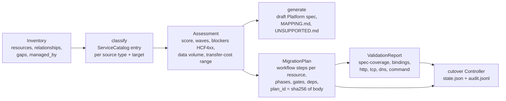

- **Classify.** Each inventory type is matched to a `ServiceCatalog` entry for the target (`compatibility`:
  equivalent, compatible, partial, re-architect, none, unknown; `hermes_support`). Unknown types go to the
  `manual-review` workflow (`HCF401`).
- **Assess.** The score is the complexity-weighted share of resources whose mapping is equivalent or compatible
  **and** inside the v1alpha1 provisioning scope. Waves come from `internal/graph` (topological, SCC-collapsed).
  Every discovery gap becomes risk `HCF404`. Transfer cost is a range computed from `PricingAssumptions`, never a
  quote.
- **Plan.** `MigrationWorkflow` templates (`migration/workflows/*.yaml`) are instantiated per resource or wave.
  Each step carries `phase`, `automation` (`manual`, `hermes` or `provider-tool`), `gate` (`none`, `approval` or
  `validation`), `reversible` and `source_impact`. `plan_id` is the SHA-256 of the canonical body, so
  `LoadPlan` detects edits.
- **Validate.** Checks are argv-only (never a shell string). `http` requires TLS unless `allow_insecure`. The
  report records the `plan_id` it was run for.
- **Cutover.** A persisted state machine over the `cutover`, `monitor` and `decommission` phases, in
  `.hermes/migrations/<plan_id[:12]>/`. Step states are `pending`, `done`, `failed` and `rolled-back`; the plan
  status moves `planned` → `in-progress` → `completed`. `--execute` requires three gates: a passing validation
  report for **this** plan that is fresher than `--max-report-age` (4 h), `--approve <prefix ≥ 8>`, and
  `--confirm-target <env>`; with `--hooks`, also the hooks file the dry-run showed and `--approve-hooks <prefix ≥ 8
  of its sha256>` (scripts the hooks invoke are not hashed). It runs declared hooks in plan order and stops at the first manual step, unmet
  dependency, failure, or source-impacting step without `--approve-source-step`. Decommission steps are never
  executed, only recorded ([ADR 0014](../decisions/0014-cutover-hooks-and-no-automatic-decommission.md)).
- **Adopt.** Separate from migration. See [IaC adoption](../migration/iac-adoption.md) and §6.4.

## 6. Sequence diagrams

### 6.1 Normal provisioning (init → validate → plan → apply)

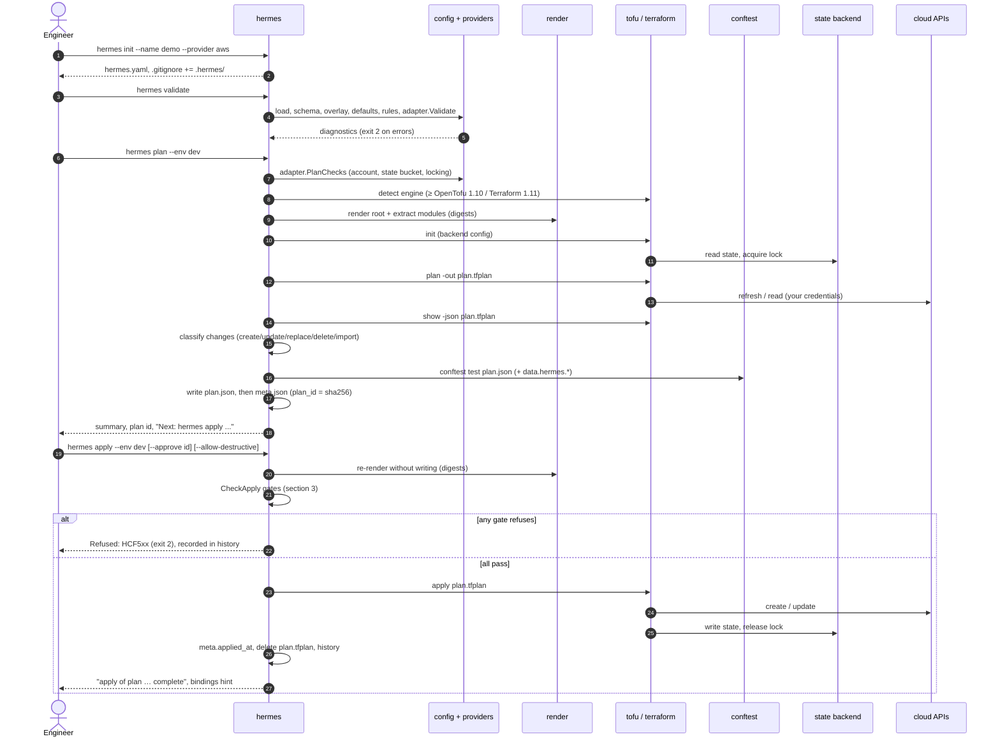

### 6.2 Multi-cloud deployment (same spec, per-environment provider, isolated state)

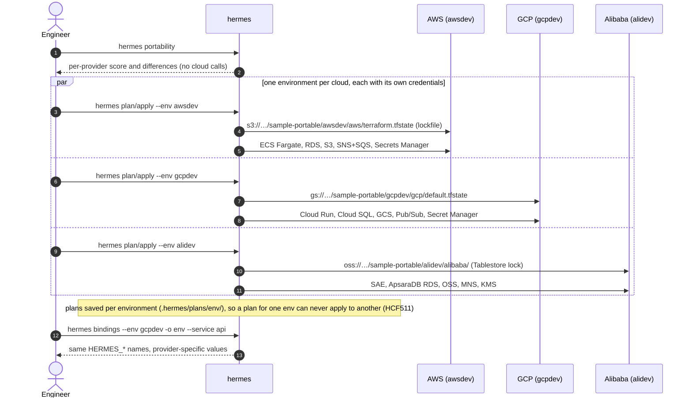

### 6.3 Existing AWS discovery (assumed role, read-only guard, gaps)

Architecture-level view. The detailed sequence, including the credential flow, is in
[discovery engine](../migration/discovery-engine.md#sequence-discovery-through-an-assumed-role).

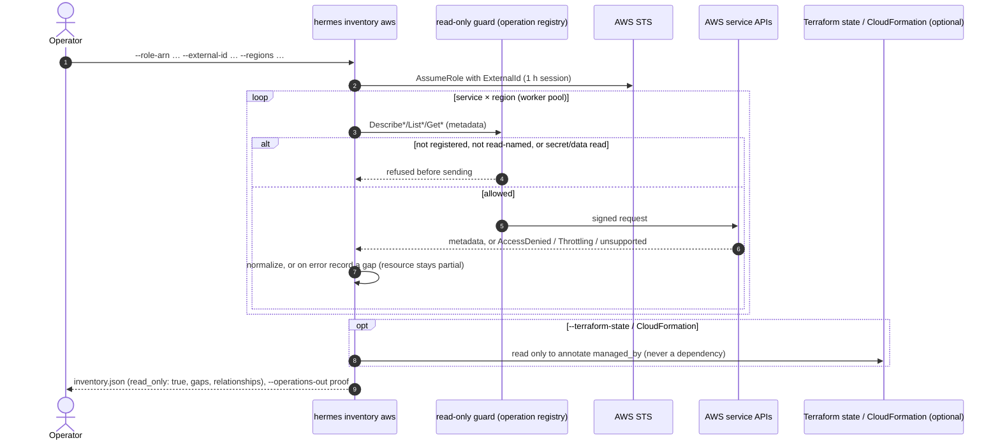

### 6.4 Terraform resource adoption (import blocks → generate-config-out → verify → apply)

Detailed view: [IaC adoption](../migration/iac-adoption.md).

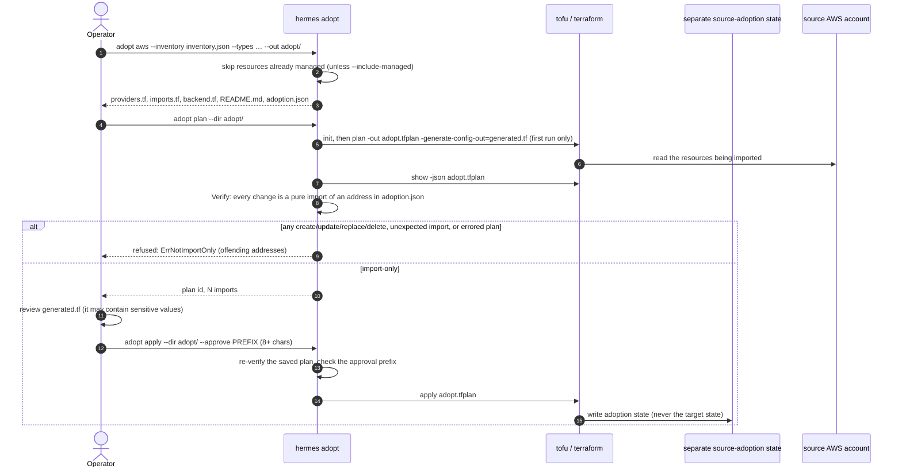

### 6.5 Database migration (continuous replication → lag → freeze → promote)

These steps come from `migration/workflows/relational-database-postgresql.yaml`. Hermes runs none of them by
itself. Each step is manual, a provider tool, or a declared hook. Provider-specific detail is in
[AWS to GCP](../migration/aws-to-gcp.md#database-migration-sequence), [database migration](../migration/database-migration.md)
and the [PostgreSQL cutover runbook](../../migration/runbooks/postgresql-cutover.md).

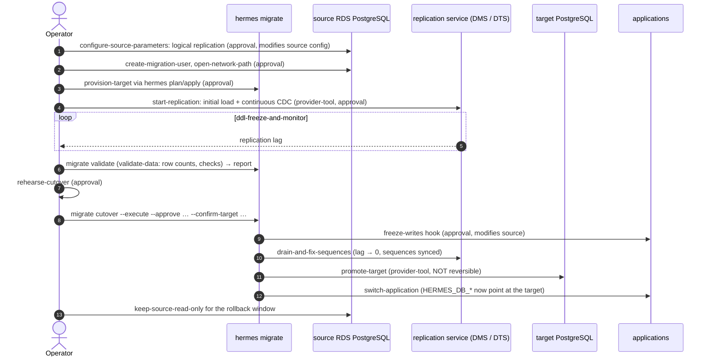

### 6.6 Traffic cutover (gated hooks)

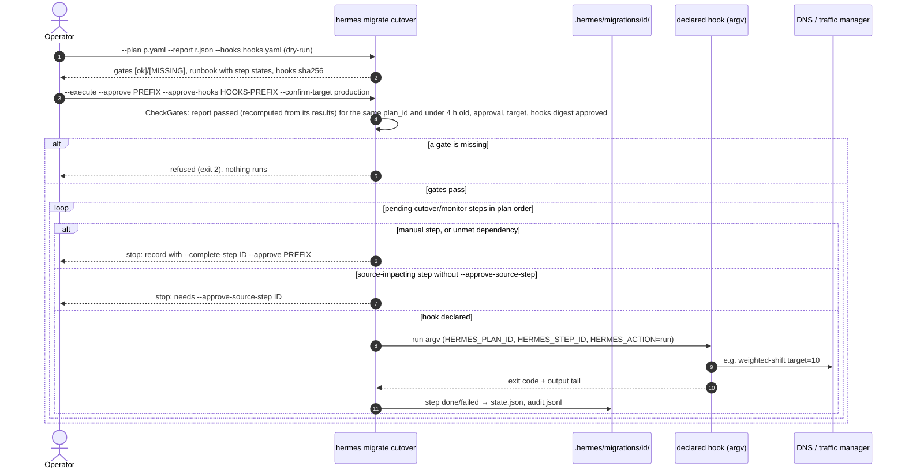

### 6.7 Rollback

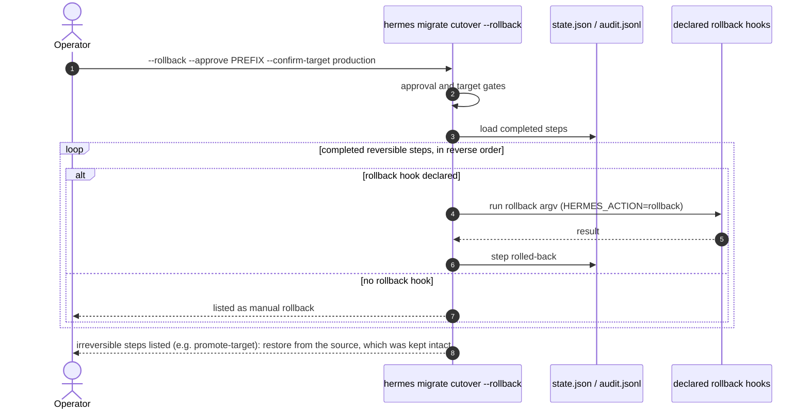

The operational procedure is in the [rollback runbook](../../migration/runbooks/rollback.md). After the target
database is promoted, rolling back to the source depends on the source having been kept read-only and intact
(`keep-source-read-only`), or on the optional reverse replication.
