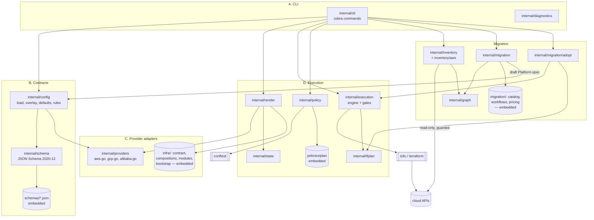

# Architecture overview

Hermes has two products that share a CLI and a set of contracts:

1. **Provisioning.** A cloud-independent spec (`hermes.yaml`, `kind: Platform`) is validated, mapped to a
   per-cloud composition, rendered as an OpenTofu/Terraform root module, and planned and applied behind safety
   gates.
2. **Migration.** An existing AWS estate is discovered read-only, classified, assessed, planned, validated and
   cut over behind gates. Hermes never depends on the estate's IaC state, and never moves data itself.

Hermes is deliberately **thin**. The engine (OpenTofu by default, or Terraform) does all planning, applying,
state handling and importing ([ADR 0001](../decisions/0001-thin-cli-over-the-engine.md),
[ADR 0002](../decisions/0002-opentofu-default-engine.md)). Every Hermes feature must add something the engine
does not: a portable spec, provider selection, validation, safety gates, portability measurement, or migration
workflow.

Status: everything below is implemented and tested offline. **Nothing has run against a real cloud**
([limitations](../limitations.md)).

## Layers

| Layer | Responsibility | Code | Contracts and docs |
|---|---|---|---|
| **A. Developer interface** | Commands, flags, output formats, exit codes, history | `cmd/hermes`, `internal/cli`, `internal/ui`, `internal/diagnostics` | [CLI reference](../reference/cli.md), [diagnostics](../reference/diagnostics.md) |
| **B. Cloud-independent contracts** | The `Platform` spec, its JSON Schema, normalization rules, the provider module contract | `schemas/`, `internal/config`, `internal/schema`, `infra/contract/` | [data contracts](data-contracts.md), [configuration](../reference/configuration.md) |
| **C. Provider adapters** | Go: regions, sizing, extension keys, capability matrix, provider blocks. HCL: one composition per cloud built from per-cloud modules | `internal/providers`, `infra/providers/
/platform`, `infra/modules/
/*` | [comparison matrix](../providers/comparison-matrix.md), [ADR 0003](../decisions/0003-capability-contracts-and-provider-compositions.md) |
| **D. Execution** | Rendering, state backend configuration, engine invocation, plan classification, policy, safety gates | `internal/render`, `internal/state`, `internal/execution`, `internal/tfplan`, `internal/policy`, `policies/` | [ADR 0004](../decisions/0004-json-rendering-and-embedded-modules.md), [0007](../decisions/0007-saved-plan-apply-and-approval-gates.md), [0008](../decisions/0008-state-isolation-and-backends.md), [0011](../decisions/0011-policy-as-code-on-plan-json.md) |
| **E. Application portability** | The `HERMES_*` binding contract, OTLP, CloudEvents, PostgreSQL | composition outputs (`bindings`, `service_environment`, `secret_environment`) | [application portability](application-portability.md), [ADR 0006](../decisions/0006-application-portability-via-standards.md) |
| **Migration** | Read-only discovery, dependency graph, catalog classification, assessment, draft spec, plan, validation, gated cutover, import-only adoption | `internal/inventory`, `internal/inventory/aws`, `internal/graph`, `internal/migration`, `internal/migration/adopt`, `migration/` | [migration lifecycle](../migration/migration-lifecycle.md), [ADR 0009](../decisions/0009-agentless-read-only-discovery.md), [0010](../decisions/0010-delegate-data-movement.md), [0014](../decisions/0014-cutover-hooks-and-no-automatic-decommission.md) |

## Components

Everything the CLI needs at runtime (modules, schemas, policies, migration data) is **embedded in the binary**
and extracted into `.hermes/` with a content digest. A saved plan is therefore tied to an exact module set
([ADR 0004](../decisions/0004-json-rendering-and-embedded-modules.md)).

## Key flows

### Spec to rendered root

`hermes.yaml` → parse (yaml.v3, keeping line numbers) → JSON Schema → deep-merge `environments.<env>` (maps merge,
lists replace) → defaults and protected-environment rules → semantic rules → provider adapter rules → normalized
`Platform` → the renderer writes `.hermes/build/<env>/main.tf.json`. That file holds exact provider pins, the
backend, the provider blocks, and a single `module "platform"` call to `providers/
/platform` with the contract
variables. Output is deterministic, and its SHA-256 digest identifies it.

### Plan and apply

`plan` runs provider plan checks, then `init` → `plan -out` → `show -json`. It classifies every resource change,
runs conftest, and saves `plan.tfplan`, `plan.json` and `meta.json` (`plan_id` = SHA-256 of the plan file).
`apply` re-renders without writing, compares digests, and evaluates the gates (stale, expired, tampered,
policy, destructive, approval, confirmation) before it runs `apply plan.tfplan`. See the
[safety-gate state machine](detailed-design.md#3-safety-gate-state-machine).

### One spec, several clouds

Each environment may select a different `cloud.provider`. State is isolated per
`<prefix>/<project>/<environment>/<provider>/` ([ADR 0008](../decisions/0008-state-isolation-and-backends.md)).
`hermes portability` scores the same spec against every capability matrix
([ADR 0015](../decisions/0015-measurable-portability.md)). See the [multi-cloud tutorial](../tutorials/multi-cloud.md).

### Migration

`inventory aws` (assumed role with ExternalId, read-only guard, gaps recorded) → `migrate assess` (catalog
classification, waves, blockers, data volume, transfer-cost range) → `migrate generate` (draft spec, mapping,
unsupported list) → `migrate plan` (workflow steps instantiated per resource, with gates and a content-hashed
`plan_id`) → `migrate validate` (declared checks → report) → `migrate cutover` (dry-run by default;
`--execute` runs only declared hooks, behind a fresh passing report, approval and target confirmation). See the
[migration lifecycle](../migration/migration-lifecycle.md) and [migration commands](../migration/migration-commands.md).

## Design principles, and where they are enforced

| Principle | Enforcement |
|---|---|
| Never apply silently | `internal/execution/gates.go` (`CheckApply`); `apply` has no plan of its own |
| Destructive changes are explicit | `tfplan.Summary.Destructive()` + `--allow-destructive` |
| Protected environments need a human | `--approve <plan-id-prefix>`; policy required; remote state required |
| No secrets in IaC, state or discovery | secret references only in outputs; discovery denylist plus IAM explicit deny ([ADR 0012](../decisions/0012-secret-values-outside-iac.md)) |
| Discovery is read-only | guard middleware over an operation registry; the IAM policy is generated from the same registry; a unit test checks both |
| Portability is measured | capability matrices + `hermes portability`; the numbers describe Hermes modules, not clouds |
| Test without credentials | fakes, mock providers, moto ([ADR 0013](../decisions/0013-testing-without-cloud-credentials.md)); see the [testing guide](../testing.md) |

## Decisions (ADR summary)

| ADR | Decision in one line |
|---|---|
| [0001](../decisions/0001-thin-cli-over-the-engine.md) | A thin CLI over the engine; no Atmos, Terragrunt or Crossplane dependency |
| [0002](../decisions/0002-opentofu-default-engine.md) | OpenTofu is the default engine; Terraform is supported |
| [0003](../decisions/0003-capability-contracts-and-provider-compositions.md) | Capability contracts with one composition per provider, not a universal cloud API |
| [0004](../decisions/0004-json-rendering-and-embedded-modules.md) | Render root modules as JSON; ship version-locked modules inside the CLI |
| [0005](../decisions/0005-serverless-containers-default-compute.md) | Serverless containers by default; Kubernetes reserved |
| [0006](../decisions/0006-application-portability-via-standards.md) | Application portability through a binding contract and open standards |
| [0007](../decisions/0007-saved-plan-apply-and-approval-gates.md) | Saved-plan-only apply with destructive and protected-environment gates |
| [0008](../decisions/0008-state-isolation-and-backends.md) | One state per project, environment and provider |
| [0009](../decisions/0009-agentless-read-only-discovery.md) | Agentless, IaC-independent, read-only discovery |
| [0010](../decisions/0010-delegate-data-movement.md) | Delegate data movement to managed migration services |
| [0011](../decisions/0011-policy-as-code-on-plan-json.md) | Policy as code with Conftest on plan JSON |
| [0012](../decisions/0012-secret-values-outside-iac.md) | Secret values never pass through IaC, state or discovery |
| [0013](../decisions/0013-testing-without-cloud-credentials.md) | Test without cloud credentials; real-cloud tests are opt-in |
| [0014](../decisions/0014-cutover-hooks-and-no-automatic-decommission.md) | Cutover runs only user-declared hooks; decommissioning is never automated |
| [0015](../decisions/0015-measurable-portability.md) | Portability is measured, not promised |

Next: [detailed design](detailed-design.md).
