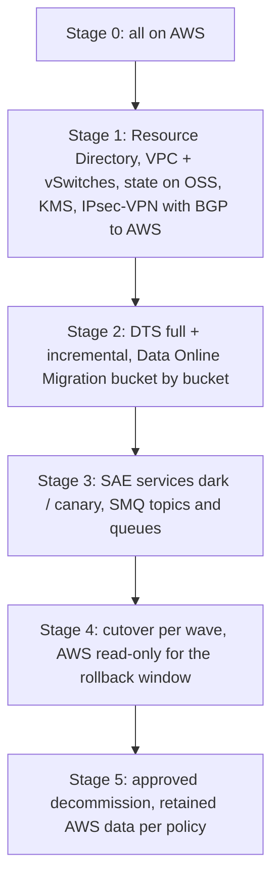
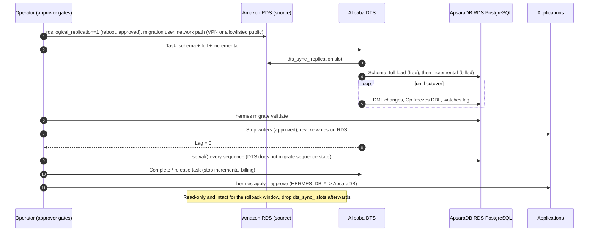
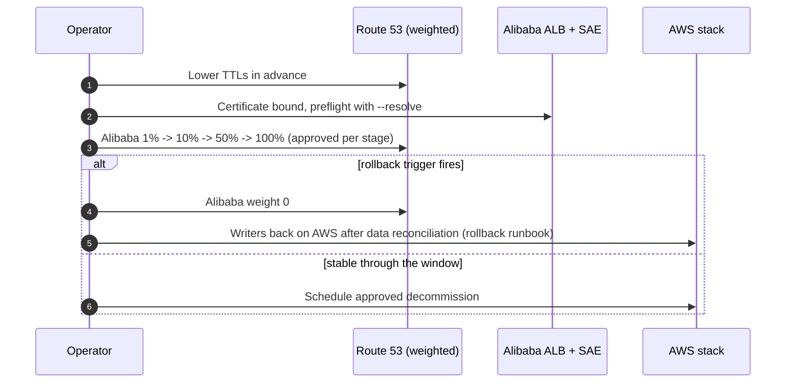

# AWS to Alibaba Cloud

> Status: designed guidance. The workflows and catalog it references are written and validated
> as data. Nothing here has been tested against a real cloud. Alibaba Cloud is the
> least-served target in the open-source tooling ecosystem
> (`docs/research/open-source-landscape.md`), so expect more manual steps than for GCP.

## Approach: phased, with a temporary hybrid architecture

## Mapping highlights

| AWS | Alibaba Cloud target | Hermes provisions | Notes |
|---|---|---|---|
| VPC, subnets, NAT | VPC, vSwitches (zonal), NAT Gateway + EIP | Yes | Security groups support allow and deny rules with priorities |
| ECS/Fargate, App Runner | Serverless App Engine (SAE) | Yes | Ingress through load balancer bindings; verify specs per region |
| EC2 (incl. Docker managed by Ansible) | ECS instances (rehost) or SAE (re-platform) | No (VMs) | Server Migration Center for rehost |
| RDS PostgreSQL | ApsaraDB RDS for PostgreSQL (PolarDB alternative) | Yes | DTS; source ≥ 10.4 with `rds.logical_replication = 1` |
| Aurora PostgreSQL | ApsaraDB RDS for PostgreSQL | Yes | Alibaba's DTS guide covers **full** migration for this source; confirm incremental support |
| RDS/Aurora MySQL | ApsaraDB RDS for MySQL / PolarDB for MySQL | No (reserved) | DTS |
| S3 | OSS | Yes | Data Online Migration (one bucket per task, **long-lived IAM user key**) or ossimport |
| SNS + SQS | SMQ (formerly MNS) topics + queues | Yes | 7-day max retention; small message size limit, so use a claim-check for large payloads |
| SQS FIFO | ApsaraMQ for RocketMQ ordered messages | No | Drain before switching |
| Secrets Manager | KMS Secrets Manager | Containers only | Values out-of-band |
| CloudWatch Logs / X-Ray | Simple Log Service / Managed Service for OpenTelemetry | Basics | OpenTelemetry first |
| Route 53 | Alibaba Cloud DNS (optional, last) | No | Weighted cutover can stay on Route 53 |
| Timestream | Lindorm | No | Do not target TSDB or TSDB for InfluxDB (both end of life) |
| IoT Core | None for new customers | No | IoT Platform stopped accepting new subscriptions |

## Data migration per category

| Category | Tool | Mode | Notes | Workflow |
|---|---|---|---|---|
| PostgreSQL | Data Transmission Service | Schema + full (free) + incremental (billed hourly while running) | DML only; no DDL during migration; DTS does not validate sequences; a source failover can break the task | `relational-database-postgresql` |
| MySQL | Data Transmission Service | Full + binlog incremental | Binlog retention must cover the full load | `relational-database-mysql` |
| Objects | Data Online Migration or ossimport | Bulk + incremental tasks | Long-lived key behind an approval gate, revoked at decommission; ossimport does not verify after copy | `object-storage` |
| Messages | Drain | Producer switch | 7-day retention on SMQ | `messaging` |
| Kafka (MSK) | MirrorMaker 2 → ApsaraMQ for Kafka | Replication + offsets | — | `messaging` |
| Secrets | Out-of-band | Re-issue preferred | — | `secrets` |

### Long-lived AWS keys: a security consideration

Data Online Migration (S3 → OSS), and also GCP Migration Center's AWS discovery, authenticate
with a long-lived IAM access key pair. Hermes discovery itself uses role assumption with an
ExternalId. Treat such a key as a temporary exception:

1. Create a dedicated IAM user, limited to `s3:ListBucket`/`s3:GetObject` on the in-scope buckets and `kms:Decrypt` where needed. This is an approval-gated step that modifies the source.
2. The operator types the key into the Alibaba Cloud console. It is never stored in Hermes artifacts, files, tickets or chat.
3. Set a calendar expiry. Delete the key in the decommission workflow (`remove-migration-artefacts`).

## Identity and secrets

RAM roles per service come from the Platform spec. Policies are rewritten: they look similar
but use different action, resource and condition names. Use CloudSSO or RAM SSO for people and
OIDC role assumption for CI. Secrets are re-issued where possible. Copied values are rotated
after cutover.

## DNS and traffic

Same pattern as GCP: weighted records in Route 53, certificates prepared in Certificate
Management Service (referenced by `extensions.alibaba.certificate_id`), and staged shifts
([runbook](../../migration/runbooks/dns-traffic-cutover.md)). Serving users in the Chinese
mainland needs an ICP filing and has separate network rules. That is out of scope here.

## Database migration sequence

## Traffic cutover and rollback sequences

## Cost

AWS data transfer out applies (tiered from about 0.09 USD/GB) and may be waived under AWS's exit
programme on request. Alibaba does not bill inbound traffic. DTS schema and full migration are
free; incremental migration is billed per hour while it runs, so release tasks promptly. Data
Online Migration was reported free during public preview (unverified); OSS request fees apply.
Alibaba CDT egress (for rollback or reverse flows) is 0.074 USD/GB in Europe and North America
and 0.10 USD/GB in Asia-Pacific for the first 10 TB, after a 200 GB/month free quota. No
Alibaba exit-waiver programme was found. See `migration/pricing/assumptions.yaml`.

## Risks

- Long-lived AWS keys required by Data Online Migration.
- DTS incremental behaviour for Aurora PostgreSQL sources not confirmed.
- SMQ message size and retention limits break payload assumptions.
- SAE specification and regional availability differences.
- Thin policy and lint tooling for Alibaba. Write guardrails as OPA policies in `policies/`.
- The same latency, relay and undiscovered-dependency risks as for GCP ([aws-to-gcp.md](aws-to-gcp.md#risks)).
