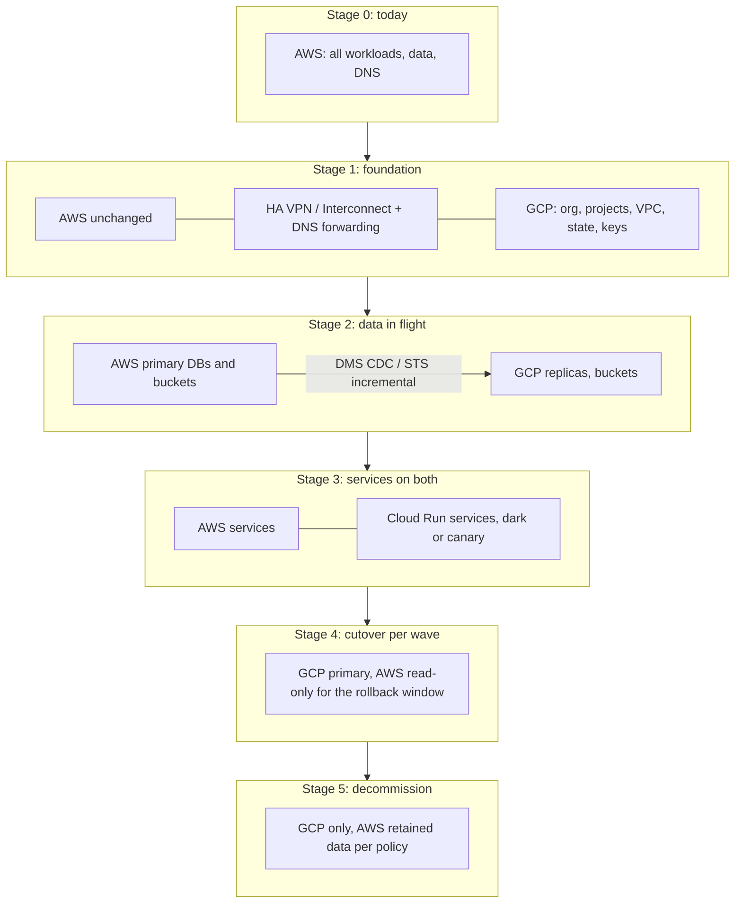
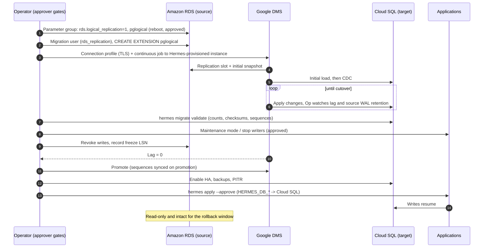
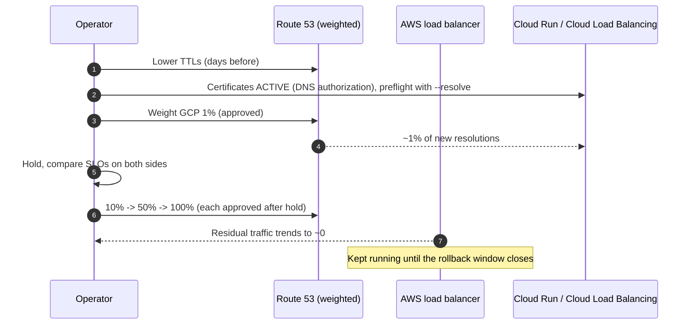
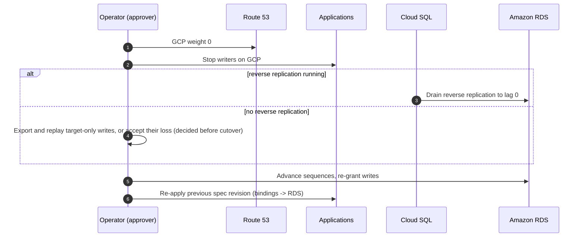

# AWS to GCP

> Status: designed guidance. The workflows and catalog it references are written and validated
> as data. Nothing here has been tested against a real cloud.

## Approach: phased, with a temporary hybrid architecture

Each wave (from the assessment's dependency graph) passes through stages 2–4 on its own.
Stage 5 needs explicit approval per batch.

## Mapping highlights

| AWS | GCP target | Hermes provisions | Notes |
|---|---|---|---|
| VPC, subnets, NAT | VPC network (global), regional subnets, Cloud NAT | Yes | Subnets are regional, not zonal |
| ECS/Fargate, App Runner | Cloud Run | Yes | HTTP/gRPC/WebSockets only; raw TCP needs GKE or VMs |
| EC2 (incl. Docker managed by Ansible) | Compute Engine (rehost) or Cloud Run (re-platform) | No (VMs) | See the container-workload `rehost-or-replatform` step |
| RDS/Aurora PostgreSQL | Cloud SQL for PostgreSQL (AlloyDB alternative) | Yes (Cloud SQL) | Google DMS continuous migration; [database guide](database-migration.md) |
| RDS/Aurora MySQL | Cloud SQL for MySQL | No (reserved) | Google DMS, no additional charge |
| S3 | Cloud Storage | Yes | Storage Transfer Service; [object storage guide](object-storage-migration.md) |
| SNS + SQS | Pub/Sub topics + subscriptions | Yes | Semantics differ ([service mapping](service-mapping.md)) |
| Secrets Manager | Secret Manager | Containers only | Values out-of-band |
| CloudWatch Logs / X-Ray | Cloud Logging / Cloud Trace via OTLP | Basics | Move instrumentation to OpenTelemetry first |
| Route 53 | Cloud DNS (optional, last) | No | Weighted cutover can stay on Route 53 |
| DynamoDB, Kinesis, Step Functions, Cognito, IoT Core | Re-architect | No | See catalog entries |

## Data migration per category

| Category | Tool | Mode | Cutover | Workflow |
|---|---|---|---|---|
| PostgreSQL | Google Database Migration Service | Initial dump + continuous CDC (pglogical) | Write freeze → promote | `relational-database-postgresql` |
| MySQL | Google Database Migration Service | Dump + binlog CDC | Write freeze → promote | `relational-database-mysql` |
| Objects | Storage Transfer Service (agentless; federated AWS role; optional managed private network) | Bulk + scheduled incrementals | Final sync, then switch bindings | `object-storage` |
| Files (EFS) | STS agent-based or rsync over the tunnel | Bulk + delta | Freeze + final delta | `manual-review` |
| Messages | None (drain) | Producers switch, consumers drain | Per producer | `messaging` |
| Kafka (MSK) | MirrorMaker 2 | Replication + offset translation | Consumer switch | `messaging` |
| Images | OCI copy by digest | One-time + per release | Spec image refs | `container-workload` |
| DynamoDB | Export to S3 + loader + Streams CDC or dual-write | Bulk + CDC | Flag flips | `nosql-database` |
| Secrets | Out-of-band by an operator | Re-issue preferred | Per service | `secrets` |

## Identity and secrets

Nothing identity-related moves through state or IaC import. Each service gets a new service
account from the Platform spec's `access` block. IAM policies are re-derived, not translated.
Humans use workforce federation. CI uses Workload Identity Federation, with no service-account
keys. Secrets are re-issued on GCP where possible (new database passwords, new API keys). Values
that cannot be re-issued are copied by an operator, then rotated after cutover.

## DNS and traffic

Keep DNS on Route 53 during the migration and use weighted records for gradual shifts
([runbook](../../migration/runbooks/dns-traffic-cutover.md)). Pre-issue Google-managed
certificates with Certificate Manager DNS authorization. Moving the zones to Cloud DNS is an
optional final step.

## Database migration sequence

## Traffic cutover sequence

## Rollback sequence

## Cost

Moving data out of AWS costs AWS data transfer out: tiered from about 0.09 USD/GB, with
100 GB/month free. Storage Transfer Service agentless transfers carry no service fee. The
managed private network replaces AWS egress with 0.03–0.08 USD/GiB, by region. Google DMS is no
additional charge for homogeneous migrations; target instances are billed. AWS offers a free
data transfer out programme for customers leaving AWS. It may apply, requires a Support request
and approval before the move, and has a time window; verify the current terms. VPN hours, request
charges, archive restores and dual running are not modelled. See
`migration/pricing/assumptions.yaml`.

## Risks

- Replication slots retaining WAL fill the source disk if a job stalls. Alarm on it.
- Tables without primary keys silently lose UPDATE/DELETE with Google DMS standard migrations.
- Cloud Run request model surprises: timeouts, concurrency, no raw TCP.
- Pub/Sub semantics: 600 s ack deadline, 7-day subscription retention, dead-letter attempts of 5–100.
- Cross-cloud latency and egress during coexistence.
- Device-facing relays moved in a bulk cutover. Never do this ([hybrid network](../../migration/runbooks/hybrid-network.md)).
- Undiscovered resources (inventory `gaps`) still in use at decommission.
