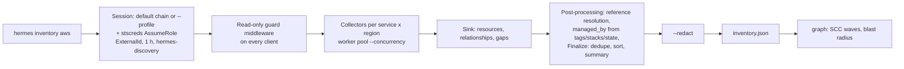
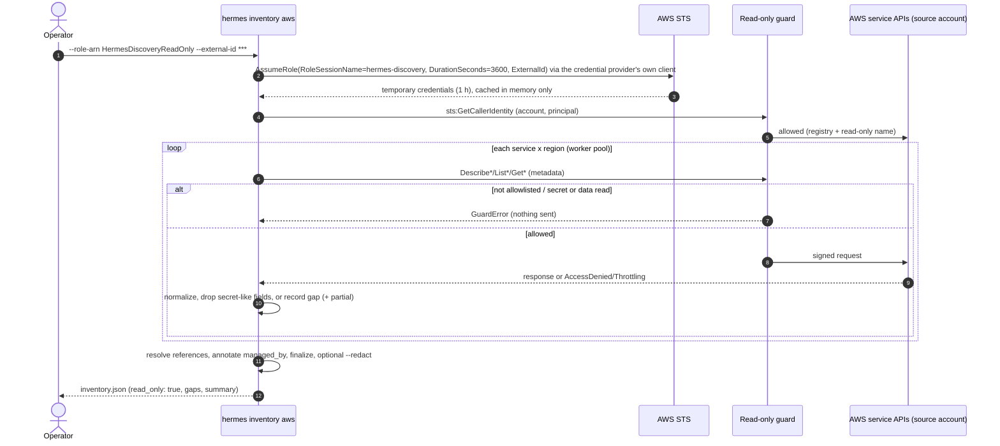

# Discovery engine (AWS)

`hermes inventory aws` builds an `Inventory` (data-contracts §3) **directly from official AWS APIs**:
it is read-only, agentless, and works when the source environment was built by hand in the console,
the CLI or an SDK. It does not depend on Terraform or CloudFormation state. Those are used only to
*annotate* `managed_by`.

| Feature | Status |
|---|---|
| 27 collectors (EC2/VPC, ELBv2, RDS, S3, ECS, EKS, Lambda, ECR, SQS, SNS, DynamoDB, ElastiCache, Kinesis, Route 53, ACM, IAM, Secrets Manager, SSM, KMS, CloudWatch Logs and alarms, CloudFront, API Gateway v2, Step Functions, EventBridge, CloudFormation annotation, Cloud Control fallback) | Implemented & verified with Go fakes. The moto demo covers the services moto supports. **Not tested against a real AWS account** |
| Read-only guard, generated IAM policy | Implemented & verified: unit tests, including a real SDK client against a local server |
| AssumeRole with ExternalId, 1-hour session | Implemented & verified against a local fake STS (request parameters and signing) and moto |
| Gaps and completeness | Implemented & verified (fakes; moto with IAM enforcement) |
| Dependency graph, waves, blast radius | Implemented & verified (unit tests, including cycles and a 20,000-node chain) |
| AWS Config import | Implemented & verified with fixtures (moto supports single-account `SelectResourceConfig`; not exercised) |
| Resource Explorer collector | Designed, not implemented |
| Other source clouds | Not supported |

## Architecture

- **Credentials.** The default credential chain or `--profile`. With `--role-arn`, Hermes assumes the
  role through the SDK `stscreds` provider: session name `hermes-discovery`, duration 1 hour, and
  `--external-id` as `ExternalId`. Credentials are cached and refreshed by the SDK. They are never
  written anywhere.
- **Regions.** `--regions`, or the regions `ec2:DescribeRegions` reports as enabled (`opt-in-not-required`
  or `opted-in`). Global services (IAM, Route 53, CloudFront, the S3 bucket listing) run once from
  `--region`. S3 bucket details use a client in the bucket's own region. Buckets outside the scanned
  regions are skipped, and the skip is recorded in `metadata.notes`.
- **Collectors** are functions over small per-service interfaces (`internal/inventory/aws/api.go`).
  Tests substitute fakes. A collector records a **gap** for every failed call and keeps going.
- **Testing endpoint.** `--endpoint-url` sets `BaseEndpoint` on every client (S3 switches to
  path-style). This is meant for moto or similar emulators.

## Read-only guard

Every operation Hermes may call is listed in `internal/inventory/aws/registry.go`
across 28 services (95 operations). A smithy middleware is inserted as the **first initialize step** of every
client (`config.APIOptions`). It refuses an operation, before validation, serialization, signing or
any network I/O, unless all of the following hold:

1. its name starts with `Describe`, `List`, `Get`, `Search`, `Select`, `Lookup` or `Head`;
2. it is not on the denylist of read-named operations that return secrets, data or download URLs
   (`GetSecretValue`, `GetParameter*`, `GetObject*`, `HeadObject`, `SelectObjectContent`, `GetFunction`
   (use `ListFunctions`), `GetLayerVersion`, `GetDownloadUrlForLayer`, `GetAuthorizationToken`,
   `GetCredentialsForIdentity`, `GetSessionToken`, `GetPasswordData`, `GetConsoleOutput`,
   `GetLaunchTemplateData`, `GetTemplate`, `GetItem`, `GetRecords`, `GetShardIterator`,
   `GetLogEvents`, `GetQueryResults`, `GetFunctionConfiguration` (environment values),
   `DescribeInstanceAttribute` and `DescribeLaunchTemplateVersions` (user data), `GetSnapshotBlock`,
   `GetJobOutput`, `GetFile`/`GetBlob`/`GetFolder`, `DescribeUserPoolClient`, `GetCommandInvocation`,
   `GetConnection*`, `GetApiKey*`, `GetCredential*`, `Decrypt`, `GenerateDataKey*` and others). The
   denylist holds even for an operation added to the registry (`TestGuardDenylistHoldsEvenIfRegistered`);
3. it is in the registry for that service.

`sts:AssumeRole` is called only by the credential provider's own STS client, which is the one client
without the guard. The guarded configuration refuses `AssumeRole`.

Tests prove:
- write operations (`DeleteBucket`, `PutObject`, `CreateVpc`, `TerminateInstances`, ...) and denied reads
  are refused;
- a refused call makes **zero** HTTP requests (a real S3 client against `httptest`);
- the method set of every collector interface equals the registry, so collectors cannot call
  anything that is not allowlisted, and the registry grants nothing they do not use;
- `migration/discovery/aws-readonly-discovery-policy.json`, the CloudFormation template and the HCL
  module policy are byte-identical to what the registry generates.

The `--operations-out` flag writes the operations actually called, with counts. In the moto demo:
81 distinct operations, all allowlisted.

## Permissions model

See [`migration/discovery/README.md`](../../migration/discovery/README.md). In short: one role per
inspected account, one trusted principal, `sts:ExternalId` required, `MaxSessionDuration` 3600, and an
inline policy of explicit read actions plus an explicit `Deny` for secret and data reads.

## What is collected, and what is never collected

Normalized attributes are listed per collector in the code. The catalog match keys are always
emitted:
- ELBv2 `type`;
- RDS `engine`;
- ElastiCache `engine`;
- SQS `fifo_queue`;
- EC2 `source_dest_check` (a VPN relay with the check disabled is classified as a network appliance).

Security-relevant configuration is captured as facts:
- security group rules, including references to other groups and `world_open_ports`;
- bucket public-access-block, ownership, encryption, policy flags (wildcard principal,
  `aws:SecureTransport` deny, cross-account principal count) and lifecycle/replication presence;
- IAM role trust principals, whether the trust requires an ExternalId, and attached/inline policy
  *names*;
- KMS rotation;
- RDS encryption, public accessibility, IAM auth and backup retention.

**Never stored** by the collectors and the Cloud Control fallback (verified with canary-value
tests: `TestDiscoveryWithFakes` for ECS, `TestLambdaEnvironmentValuesNeverStored`,
`TestCloudControlFallbackStoresIdentifiersAndTagsOnly`):
- secret values (Secrets Manager and SSM: metadata only);
- environment variable values (Lambda and ECS task definitions: names only);
- EC2 user data and launch-template data (no collector calls an operation that returns them;
  `TestRegistryHasNoUserDataOperations`);
- VPN pre-shared keys and customer gateway configuration;
- SNS email/SMS/HTTP endpoints;
- policy documents, Step Functions definitions (only the ARNs they reference) and object or table
  data.

The Cloud Control fallback (`--cloudcontrol-types`) records **identifier, type, region and tags
only** (`completeness: identifier-only`; the ARN is the resource id when the model has one). It
never stores properties, because a Cloud Control model can carry secret values under keys no
name filter recognises (for example ECS `Environment[].Value`, Lambda `Environment.Variables`,
launch-template `UserData`, SSM parameter `Value`). It calls `ListResources` only, never
`GetResource` (the full model); the ListResources properties are parsed in memory for the ARN and
the tags and then discarded. Tag values are stored as tags, like every collector does.

The AWS Config import (`hermes inventory import --format aws-config`) is the one path that stores
a generic property bag (`completeness: partial`). Hermes drops every key whose name matches
`password|secret|token|privatekey|private_key|credential|passphrase` and every value-bearing key
named `environment`, `variables`, `environmentvariables` or `userdata` (case-insensitive, at any
depth), but it cannot prove that a property under another name holds no secret: review an
imported inventory before sharing it.

`--redact` replaces the account id and every 12-digit account number in ARNs and trust principals with
`REDACTED`. Names, tags and CIDRs are kept for planning, so review them before sharing.

## Gaps and completeness

| SDK outcome | `gaps[].reason` |
|---|---|
| `AccessDenied*`, `UnauthorizedOperation`, `AuthorizationError`, HTTP 403 | `access-denied` |
| `OptInRequired` | `opt-in-region-disabled` |
| Throttling codes after SDK retries (`--max-attempts`, default 5), HTTP 429 | `throttled` |
| `UnsupportedOperation`, `InvalidAction`, `NotImplemented`, HTTP 501, HTTP 404 without an error code, DNS failure for a service endpoint | `unsupported` |
| `SubscriptionRequiredException` and similar | `not-enabled` |
| anything else, including a guard refusal | `error` |

- A failed **list** call means the whole resource type is missing in that region. The gap says
  so in `impact`.
- A failed **detail** call (for example `GetBucketPolicy`) records a gap with `resource_id` and marks
  the resource `completeness: partial`.
- Resources known only by identifier are `identifier-only`. Examples: AWS Config imports without
  `configuration`, or a table whose `DescribeTable` failed.
- "Not configured" answers such as `NoSuchBucketPolicy` or `ServerSideEncryptionConfigurationNotFoundError`
  are facts, not gaps.

`hermes migrate assess` carries every gap into the assessment as risk `HCF404`, because undiscovered
scope is migration risk.

## Relationships and the dependency graph

Relationships use the contract vocabulary. They always point from the dependent resource to its
dependency:
- subnet `in-vpc` VPC;
- DB `uses-security-group` SG;
- SG `allows-ingress-from` SG;
- route table `routes-to` NAT, IGW, VGW, TGW or peering;
- resource `encrypted-by` KMS key;
- compute `assumes-role` role (EC2 is resolved through the instance profile);
- task definition `uses-secret` secret (partial ARNs without the random suffix are resolved);
- queue `subscribes-to` topic;
- queue `depends-on` its DLQ;
- target group `targets` instances or ECS service;
- event source mapping `reads-from` queue or stream;
- CloudFront `reads-from` its S3 origin;
- EventBridge rule and API integration `targets`.

Aliases are resolved after collection: KMS aliases and key ids, Secrets Manager suffixes, instance
profiles, and load balancer DNS names. Inferred edges, such as ARNs found in Step Functions
definitions, are kept only when the target was discovered.

`internal/graph`:
- builds the graph (unknown targets become `external` nodes);
- computes strongly connected components (Tarjan, iterative);
- derives topological **waves** over the condensation. Wave 0 has no dependencies; members of a cycle
  share a wave; external nodes are excluded.

`hermes inventory graph --format mermaid|dot|json [--focus <id>]` renders the graph, or just the
**blast radius** of one resource: its transitive dependents (affected if it changes or moves) and its
transitive dependencies (needed on the target first).

## managed_by annotation (never a dependency)

- the tag `aws:cloudformation:stack-name`;
- physical resource ids of stacks (`DescribeStacks` and `ListStackResources`);
- `--terraform-state <file>` (repeatable): state v4 JSON, matched on `arn` or `id`.

An inventory without any IaC is fully valid. `hermes adopt aws` skips resources that are already
managed, to avoid dual management.

## Sequence: discovery through an assumed role

## Importers and complementary sources

`hermes inventory import --format aws-config results.json...` converts AWS Config advanced query results
into an Inventory (collector `aws-config`, completeness at most `partial`). It also adds a `not-enabled`
gap, because Config only returns recorded types. Google Migration Center and AWS Application Discovery
Service exports are **complementary** sizing sources (utilization, server inventories). They are not
imported. Their discovery authenticates with long-lived access keys, which is a weaker posture than
role assumption with an ExternalId (see `docs/research/open-source-landscape.md` §5.4).

## Testing

- `go test ./internal/inventory/... ./internal/graph/` uses fakes and `httptest`; there is no network.
- The moto demo: `examples/migration/aws-discovery-demo/run-demo.sh`. The integration test runs with
  `go test -tags moto ./tests/integration/discovery/...` once `HERMES_MOTO_ENDPOINT` points at the demo
  server.
- The opt-in real-account test is `tests/integration/aws-real` (`-tags realaws`,
  `HERMES_IT_ALLOW_REAL_AWS=1`). The maintainers never run it.
