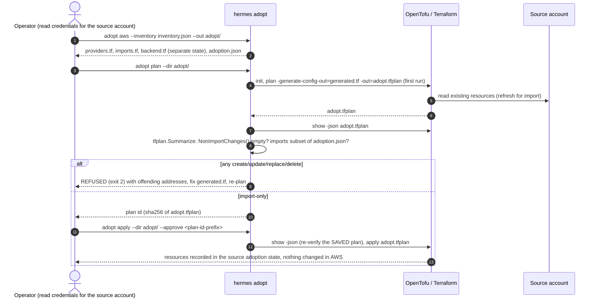

# IaC adoption: import existing source resources without changing them

IaC adoption is **optional and separate from migration**. It brings hand-built *source* resources
under OpenTofu/Terraform management so the source can be changed safely (for example enabling
logical replication) or decommissioned through an owning tool. Nothing moves to the target, and the
adoption state is **never** the Hermes target state.

| Feature | Status |
|---|---|
| `hermes adopt aws` (import blocks, providers, separate backend, README, manifest) | Implemented & verified (unit and CLI tests on the sample inventory) |
| `hermes adopt plan` / `verify` / `apply` gates | Implemented & verified with a fake engine and canned plan JSON. **Not run against real AWS** (they need real read credentials; the operator runs them) |

## What `hermes adopt aws` writes

```bash
hermes adopt aws --inventory inventory.json [--types AWS::S3::Bucket,AWS::SQS::Queue] [--ids <id>,...] \
  (--backend-bucket <bucket> --backend-region <region> | --allow-local-state) --out adopt/
```

**The adoption state is sensitive.** Importing writes the *full* configuration of every resource
into the adoption state, for example Lambda `environment.variables` and ECS task definition
environment values. Store it like a secret: an encrypted remote backend with restricted access
(`--backend-bucket`: S3 with `encrypt = true`), or OpenTofu state encryption. `hermes adopt aws`
therefore **refuses a local backend** unless `--allow-local-state` is given, and `adopt plan` /
`adopt apply` refuse a workspace whose `backend.tf` was switched to local (or removed) afterwards
unless the manifest records that opt-in. Every `adopt aws` and `adopt plan` prints this warning.
*Implemented & verified with unit and CLI tests (fake engine).*

| File | Content |
|---|---|
| `providers.tf` | `hashicorp/aws` `~> 6.73` (the constraint the Hermes AWS modules use). One aliased provider per region with `allowed_account_ids = ["<inventory account>"]` |
| `imports.tf` | One `import { to = <address> id = "<import id>" provider = aws.<region> }` per resource |
| `backend.tf` | A separate **source adoption** state: S3 with key `source-adoption/<account>/terraform.tfstate`, `encrypt` and `use_lockfile` (`--backend-bucket`), or, only with `--allow-local-state`, local `state/source-adoption.tfstate` |
| `adoption.json` | Manifest: inventory digest, account, `local_state_allowed`, every import, every skipped resource with its reason |
| `README.md` | The exact steps below |

Import ids follow the AWS provider's import formats:

| Inventory type | Terraform type | Import id |
|---|---|---|
| S3 bucket | `aws_s3_bucket` | bucket name |
| SQS queue | `aws_sqs_queue` | queue URL |
| SNS topic / subscription | `aws_sns_topic` / `aws_sns_topic_subscription` | ARN |
| RDS instance / cluster / subnet group | `aws_db_instance` / `aws_rds_cluster` / `aws_db_subnet_group` | identifier / name |
| VPC, subnet, SG, route table, IGW, NAT, instance, volume, VPC endpoint, TGW, VGW, peering | `aws_vpc`, `aws_subnet`, ... | resource id |
| DynamoDB table, Lambda function, ECS cluster, ECR repository, EKS cluster, IAM role, log group, alarm, Kinesis stream, EventBridge bus | ... | name |
| ECS service | `aws_ecs_service` | `cluster/service` |
| EKS node group | `aws_eks_node_group` | `cluster:nodegroup` |
| EventBridge rule | `aws_cloudwatch_event_rule` | `[bus/]rule` |
| KMS key | `aws_kms_key` | key id |
| Secrets Manager secret, LB, listener, target group, ACM certificate, task definition, state machine | ... | ARN |
| Route 53 zone, CloudFront distribution, API Gateway v2 API, ElastiCache group/cluster, event source mapping | ... | zone id / distribution id / API id / id / UUID |

The generator **skips**, listing the reason in the README and the manifest:
- types whose imported state would contain secret values, which are **never adoptable** (an
  explicit `--types` request is refused): SSM parameters (`aws_ssm_parameter` reads the value,
  decrypted for SecureString, and the configuration needs `value`) and VPN connections
  (`aws_vpn_connection` stores the tunnel pre-shared keys);
- types without a mapping (for example IoT or Timestream from Cloud Control);
- resources without a known import id (identifier-only inventory);
- resources already managed by Terraform or CloudFormation. Adopting them would create dual
  management; `--include-managed` overrides this deliberately.

It refuses redacted inventories, because `allowed_account_ids` would be unknown.

## The safety gate: import-only plans

An adoption plan is acceptable only if **every** change is a pure import. `tfplan.NonImportChanges()`
must be empty: any `create`, `update`, `delete`, `replace` (`delete`+`create`), or an import combined
with an update means the configuration would modify the real resource, so Hermes refuses. Hermes also
refuses imports of addresses that are not in `adoption.json`, and plans that errored.



Steps:
1. Review `imports.tf`, `providers.tf` (check `allowed_account_ids`) and `backend.tf`.
2. `hermes adopt plan --dir adopt/`. This runs `init` and `plan -generate-config-out=generated.tf
   -out=adopt.tfplan` (configuration is generated on the first run only), then verifies the plan.
3. **Review `generated.tf`.** Generated configuration is experimental in both engines and can contain
   sensitive values. Remove secrets and fix arguments until the plan shows only imports.
4. `hermes adopt verify --dir adopt/` re-checks the saved plan at any time.
   `adopt plan` and `adopt verify` also run the embedded plan policies (conftest) on the adoption
   plan. Their findings are **advisory** warnings (recorded under `policy` in `-o json`), because
   verify already refuses every non-import change: a finding describes the existing source
   configuration being imported (for example a public bucket), not a change.
5. `hermes adopt apply --dir adopt/ --approve <plan-id-prefix>` re-verifies the saved plan, checks the
   8+ character prefix of the plan id (sha256 of `adopt.tfplan`), and applies **that saved plan
   only**. The engine wrapper refuses `-auto-approve`.

After adoption, any later apply in this workspace could change production. Always require a
no-changes plan before applying there (see the `adopt-source-iac` step of the foundation workflow).
