# Migration lifecycle

Hermes treats a cloud migration as a sequence of explicit, gated operations. It is **not** a
Terraform provider swap. Source and target have separate state, separate plans and separate
credentials. Resource identity never moves from one to the other. Creating target
infrastructure does not migrate data, credentials, DNS or traffic. Each of those is its own
step with its own validation.

> Status: the lifecycle, the data files (`migration/`) and the workflows are written and
> checked against the contracts by a local validator. The commands named below belong to the
> migration engine workstream (see `docs/migration/migration-commands.md`). Their
> implementation status is tracked in `docs/limitations.md`. Nothing here has been tested
> against a real cloud.

## Five activities that must never be blurred

| Activity | What it means | What it is not |
|---|---|---|
| **Infrastructure discovery** | Read-only, agentless inventory of the source through official AWS APIs, using a read-only cross-account role with an ExternalId | Not dependent on Terraform/CloudFormation; works for hand-built environments |
| **IaC adoption** | Importing existing *source* resources into a separate source state without modifying them (`hermes adopt aws` generates import blocks) | Not migration; nothing moves; optional |
| **Destination provisioning** | Creating target infrastructure from the Platform spec (`hermes plan` / `hermes apply`) | Not data migration; an empty database is not a migrated database |
| **Data migration** | Copying and synchronizing data (databases, objects, messages, secrets) with managed tools | Not a by-product of IaC; never done through state |
| **Application migration** | Moving workloads, configuration bindings and, finally, traffic (cutover) | Never automatic; every cutover step is human-approved |

## The twelve stages

```mermaid
flowchart LR
  D[1 Discover] --> I[2 Inventory] --> C[3 Classify] --> A[4 Assess] --> E[5 Estimate cost]
  E --> G[6 Generate plan] --> P[7 Provision target] --> S[8 Import / sync data]
  S --> V[9 Validate] --> X[10 Controlled cutover] --> M[11 Monitor] --> R[12 Decommission]
  V -- fails --> S
  X -- rollback --> M
  classDef gate fill:#fde68a,stroke:#92400e,color:#111;
  class X,R gate;
```

Highlighted stages (10 and 12) only proceed with explicit human approval. Some gates inside
earlier stages are approval gates too, for example any step that modifies the source.

| # | Stage | Activity | Hermes command | Hermes automates | Delegated to | Left manual |
|---|---|---|---|---|---|---|
| 1 | Discover | Discovery | `hermes inventory aws` | Read-only API calls with role assumption (ExternalId), gap recording | AWS APIs | Creating the read-only role in each source account |
| 2 | Inventory | Discovery | `hermes inventory aws` (output `inventory.json`) | Normalization, relationships, `managed_by` annotation, redaction | — | Triaging `gaps` |
| 3 | Classify | Discovery → assessment | `hermes migrate assess` | Matching resources to `ServiceCatalog` entries | — | Reviewing `manual-review` and `unknown` items |
| 4 | Assess | Assessment | `hermes migrate assess` | Portability score, blockers, dependency waves, `draft_spec` | — | Scope decisions (migrate, rebuild, retire, keep) |
| 5 | Estimate cost | Assessment | `hermes migrate assess` | Transfer cost ranges from `PricingAssumptions` | — | Negotiated rates, exit programme requests |
| 6 | Generate plan | Planning | `hermes migrate plan`, `hermes migrate generate` | Ordered `MigrationPlan` from workflows; generated target spec/artefacts | — | Reviewing every step and gate |
| 7 | Provision target | Destination provisioning | `hermes plan` / `hermes apply --approve` on the target environment | Rendering, plan safety gates, applying a saved plan | OpenTofu/Terraform | Organization setup, hybrid connectivity, unsupported services |
| 8 | Import / sync data | Data migration (and optional IaC adoption: `hermes adopt aws`) | — (plan steps reference provider tools) | Step tracking only | Google DMS, Alibaba DTS, Storage Transfer Service, Data Online Migration, native replication | Starting jobs, entering credentials out-of-band |
| 9 | Validate | Data and application migration | `hermes migrate validate` | Running `ValidationChecks` (counts, checksums, presence) and writing a report | Provider APIs (read-only) | Defining checks, business acceptance |
| 10 | Controlled cutover | Application migration | `hermes migrate cutover` | Gate checks, recording approvals (see migration-commands.md) | DNS provider, migration tools (promotion) | Write freeze, promotion, weight changes, go/no-go |
| 11 | Monitor | Application migration | `hermes migrate validate` (repeatable) | Re-running checks | Provider monitoring | Watching SLOs; closing the rollback window |
| 12 | Decommission | — | none (Hermes never deletes source resources) | — | Owning IaC tool or console | Everything, behind approvals ([runbook](../../migration/runbooks/source-decommission.md)) |

## Where each file fits

| File | Kind | Used in stage |
|---|---|---|
| `inventory.json` | `Inventory` | 2–4 |
| `migration/mappings/catalog.yaml` | `ServiceCatalog` | 3–4 ([how to read it](service-mapping.md)) |
| `migration/pricing/assumptions.yaml` | `PricingAssumptions` | 5 |
| `migration/workflows/*.yaml` | `MigrationWorkflow` | 6 |
| `migration-plan.yaml` | `MigrationPlan` | 6–12 |
| `checks.yaml` / `validation-report.json` | `ValidationChecks` / `ValidationReport` | 9, 11 |
| `migration/runbooks/*.md` | human procedures | 8–12 |

## Gate rules (enforced on the workflow data)

- Every step whose `source_impact` is `modifies-source-config` has `gate: approval`.
- Every step in the `cutover` or `decommission` phase has `gate: approval`.
- No step deletes source resources automatically. Decommission steps are `automation: manual`.
- Secrets are never read by discovery, never stored in state, and never passed through Hermes. Values are set out-of-band ([secrets workflow](../../migration/workflows/secrets.yaml)).

## Phased, incremental migration

Migrate in waves derived from the dependency graph. Foundation and connectivity come first.
Stateless and data-light services follow, then data stores (with replication running long
before cutover), then traffic. Device-facing relays and VPN endpoints are a separate track with
a dual-running window ([hybrid-network runbook](../../migration/runbooks/hybrid-network.md)).
Provider guides: [AWS to GCP](aws-to-gcp.md), [AWS to Alibaba Cloud](aws-to-alibaba.md).
