# Network migration

> Status: designed guidance backed by the `foundation`, `hybrid-connectivity` and
> `traffic-cutover` workflows and the [hybrid network runbook](../../migration/runbooks/hybrid-network.md).
> Hermes provisions the target VPC, subnets and NAT. Hybrid connectivity, DNS hosting and
> firewall translation are not provisioned by Hermes v1alpha1. Not tested against a real cloud.

## Stages

```mermaid
flowchart LR
  N0[0 Plan: CIDRs, ASNs, segments] --> N1[1 Target VPC via Hermes]
  N1 --> N2[2 Private link: HA VPN / Interconnect / IPsec-VPN / Express Connect]
  N2 --> N3[3 Routes + firewalls limited to migration flows]
  N3 --> N4[4 DNS forwarding both ways]
  N4 --> N5[5 Coexistence: replication + cross-cloud calls]
  N5 --> N6[6 Traffic cutover via weighted DNS]
  N6 --> N7[7 Relays and device endpoints: separate cohort track]
  N7 --> N8[8 Remove link, optional DNS hosting move]
```

## VPC design differences

| | AWS | GCP | Alibaba Cloud |
|---|---|---|---|
| Network scope | Regional VPC | Global VPC | Regional VPC |
| Subnet scope | Availability Zone | Region | Zone (vSwitch) |
| Internet egress | IGW + NAT gateway per AZ | Cloud NAT on Cloud Router (regional) | NAT Gateway + EIP SNAT |
| Filtering | Security groups + NACLs | VPC firewall rules / network firewall policies (tags, service accounts) | Security groups (allow and deny, priorities) + network ACLs |
| Transit | Transit Gateway | Network Connectivity Center, Shared VPC | CEN with transit routers |
| Private service access | VPC endpoints / PrivateLink | Private Service Connect, Private Google Access | PrivateLink |

Security groups do not translate 1:1 to GCP firewall rules. Hermes generates least-privilege
rules for its own services from the spec. Other rule sets are re-derived.

## Segmentation

Keep the migration link in its own segment. Advertise only the prefixes that migration needs.
Use separate route tables (AWS) and dedicated firewall policies (target). Never extend a flat
network across clouds. Protected environments get their own link or at least their own routes
and rules.

## Private connectivity options

| Option | Pair | Capacity and SLA | Lead time | Notes |
|---|---|---|---|---|
| HA VPN + Cloud Router | AWS ↔ GCP | IPsec tunnels aggregated with ECMP. 99.99% SLA with four tunnels to AWS | Hours | Internet path; AWS DTO plus hourly fees |
| AWS Interconnect – multicloud / Cross-Cloud Interconnect | AWS ↔ GCP | Dedicated, bandwidth selected | Days to weeks | GA April 2026 in a limited set of region pairs |
| VPN Gateway IPsec-VPN (dual tunnel, BGP) | AWS ↔ Alibaba | IPsec | Hours | Two customer gateways on AWS |
| Express Connect via partner | AWS ↔ Alibaba | Dedicated | Weeks | Partner contract |

## DNS during coexistence and switching

- Private names: target forwarding zones → Route 53 Resolver inbound endpoints, and Route 53 Resolver outbound rules → target resolvers. Avoid forwarding loops and overlapping private zones.
- Public switching: weighted records in the existing DNS provider, low TTLs set in advance, health checks per record ([DNS runbook](../../migration/runbooks/dns-traffic-cutover.md)).
- Moving DNS hosting is optional and comes last. Alias records become A/AAAA or CNAME records. DNSSEC needs a safe DS-record procedure.

## Latency and cost

Cross-cloud round trips add tens of milliseconds. Move tightly coupled services in the same
wave. VPN traffic leaving AWS is billed at AWS data transfer out rates plus per-connection hourly
fees. Dedicated interconnects are priced by bandwidth. Reverse traffic leaves the target at its
egress rates. None of these link fees are in `PricingAssumptions`.

## VPN relays and device traffic

EC2 instances with source/destination check disabled, and Client VPN endpoints, are classified
separately (`aws-ec2-network-appliance`, `aws-client-vpn`). Relays that carry device
command-and-control traffic are safety-critical. Run old and new relays in parallel for a
dual-running window and move devices in small cohorts with a fallback. Never move them as part
of a bulk cutover.
