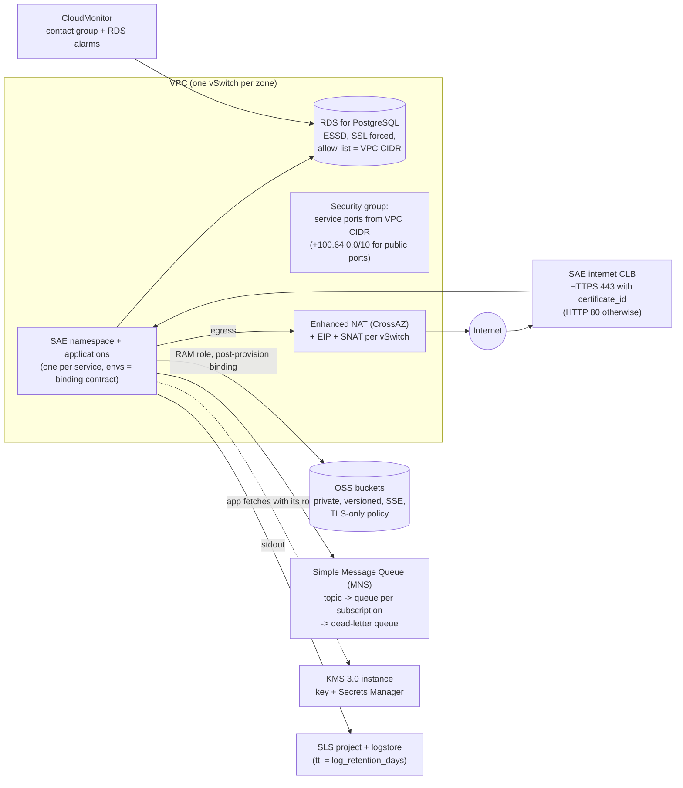

# Alibaba Cloud provider (v1alpha1)

Status: **implemented, validated with mock providers only. Nothing here has been tested against a
real Alibaba Cloud account.** Mocks prove wiring, contract shape and guardrails. They do not prove
that Alibaba Cloud accepts the requests, so every "implemented" feature below is
"implemented, not tested against a real cloud" unless stated otherwise.

Alibaba is the least mature Hermes target. It has no TFLint ruleset, no Trivy checks, few Checkov
checks, no Infracost pricing and no OpenTofu state-encryption key provider. Policies for it must be
written as conftest/OPA rules in `policies/`.

| Item | Value |
|---|---|
| Provider | `aliyun/alicloud` `~> 2.2` (tested with **2.2.0**), `hashicorp/random` `~> 3.9` (tested with **3.9.1**) |
| Engines | OpenTofu 1.13.9: `init -backend=false`, `validate`, `test` (mock providers). Terraform 1.15: see "Verification" |
| Composition | `infra/providers/alibaba/platform` (contract `variables.tf` copied verbatim) |
| Modules | `infra/modules/alibaba/{naming,network,kms,container-service,postgres,object-storage,messaging,secrets,observability}` |
| State bootstrap | `infra/bootstrap/alibaba/state-backend` |

The calling root module must configure the provider and pass the same region:
`provider "alicloud" { region = var.region }`. The composition has no provider block of its own.

## Architecture



## Service choices

| Capability | Alibaba service | Why |
|---|---|---|
| network | VPC, vSwitch per zone, enhanced NAT gateway (`availability_mode = CrossAZ`), EIP, SNAT entries | Private egress without public IPs on workloads. An enhanced NAT adds the `0.0.0.0/0` route itself and spans zones by default. |
| compute | Serverless App Engine (SAE) `alicloud_sae_application` (`package_type = Image`) | The managed, serverless container runtime closest to Cloud Run and ECS Fargate, with no cluster to operate. |
| database | ApsaraDB RDS for PostgreSQL (`alicloud_db_instance`, ESSD) | Managed PostgreSQL with HA Edition (a standby in a second zone), backups and log backup. |
| storage | OSS (`alicloud_oss_bucket` + `_acl`, `_public_access_block`, `_policy`) | Inline `acl`/`policy` are deprecated in the provider, so they are separate resources. |
| messaging | Simple Message Queue, formerly MNS (`alicloud_message_service_topic/_queue/_subscription`) | Topic push to a durable queue per subscription; the queue `dlq_policy` gives dead-lettering. The `alicloud_mns_*` resources are deprecated. |
| secrets | KMS Secrets Manager (`alicloud_kms_secret`) | The native secret store. KMS 3.0 requires a KMS instance (see limitations). |
| observability | SLS project + logstore, SAE `sls_configs` (stdout), CloudMonitor contact/group/alarms | Native log shipping without agents. |
| identity | RAM role + custom policy per service | Least privilege derived from `access`. |
| state | OSS bucket + Tablestore table (`LockID` String primary key) | The `oss` backend locks through Tablestore. |

No registry modules are used. Every resource is an official `alicloud` resource, and each argument
was checked against the v2.2.0 docs and confirmed by `tofu validate` against the 2.2.0 schema.

## Feature matrix

"Mock-tested" means covered by a `tofu test` run with mock providers. None of these features is
tested on a real cloud.

| Feature | Status | Note |
|---|---|---|
| compute.public_https | implemented & mock-tested | SAE internet CLB. HTTPS:443 with `extensions.alibaba.certificate_id`, HTTP:80 without one. Protected + public + no certificate is a plan error. |
| compute.scale_to_zero | not supported | SAE keeps at least 1 instance, so `min_instances = 0` becomes 1. A CPU scaling rule (target 70%) is created when `max > min`. |
| compute.otel_sidecar | not implemented | The provider has no sidecar argument. Services export to `extensions.alibaba.otlp_endpoint`, for example an OTel Collector in the VPC. |
| database.high_availability | implemented & mock-tested | HighAvailability Edition with `zone_id_slave_a` = second zone and both vSwitches. |
| database.postgis | partial | Supported by RDS PostgreSQL but not automated: run `CREATE EXTENSION postgis;` after provisioning. |
| database.iam_auth | not supported | Password authentication. The `app` account is created out-of-band, so no password ever reaches state. |
| database.pitr | partial | Log backup is enabled only on HighAvailability Edition, because Basic Edition cannot configure log backup. |
| database.customer_managed_keys | implemented & mock-tested | `encryption_key` = the Hermes KMS key. RDS must first be authorized to use KMS (see post-provision). |
| storage.versioning | implemented & mock-tested | Once enabled, versioning cannot return to "disabled"; turning it off needs a manual change to `Suspended`. |
| storage.retention | implemented & mock-tested | Lifecycle expiration (plus noncurrent-version expiration when versioned), and a 7-day multipart cleanup on every bucket. |
| storage.customer_managed_keys | implemented & mock-tested | SSE-KMS with the Hermes key; AES256 otherwise. |
| messaging.dead_letter | implemented & mock-tested | `dlq_policy` (`max_receive_count` = `max_delivery_attempts`) to a `<sub>-dlq` queue with 7-day retention. No DLQ when the value is 0. |
| messaging.retention | implemented & mock-tested | Queue `message_retention_period` = `retention_hours` × 3600 (7-day maximum). Topics do not retain messages. |
| secrets.native_injection | not implemented | SAE in provider 2.2 cannot inject KMS secrets. `secret_environment` lists the secret names, and the app reads them with `kms:GetSecretValue` through its role. |
| observability.logs_retention | implemented, mock-validated via contract runs | SLS logstore `retention_period` = `log_retention_days`, service-key encryption, SAE stdout shipping. |
| observability.alerts | partial | E-mail contact + group, plus RDS `CpuUsage`/`DiskUsage` ≥ 80% alarms (namespace `acs_rds_dashboard`; the metric names were not re-verified for PostgreSQL). There are no SAE or queue alarms, and the e-mail must be activated. |
| observability.tracing | partial | OTEL_* env vars are injected. The endpoint comes only from the extension (`""` when unset or when tracing is off), and no collector is provisioned. |
| state.remote_backend | implemented & mock-tested (plan-only) | Private, versioned, SSE, TLS-only bucket with `prevent_destroy`. |
| state.locking | implemented & mock-tested (plan-only) | Tablestore table `hermes_state_lock`, PK `LockID` (String), SSE. |
| state.client_side_encryption | not implemented | OpenTofu has no Alibaba KMS key provider; validation rejects `state.encryption.client_side` on Alibaba. |
| identity.per_service | partial | RAM role + least-privilege policy per service, mock-tested. The provider cannot bind a role to an SAE app, so binding is a post-provision step. The trust policy names explicit principals only: the SAE service principal `sae.aliyuncs.com` by default, or the RAM ARNs in `workload_role_trusted_principals`. It never trusts the account root (`acs:ram::<account>:root`); module and composition tests assert this. |

## Sizes

**Database** (general-purpose classes on cloud disks, from the RDS for PostgreSQL instance-type list):

| size | HighAvailability | Basic |
|---|---|---|
| small | `pg.n2.2c.2m` (2 vCPU / 4 GB) | `pg.n2.2c.1m` |
| medium | `pg.n4.2c.2m` (2 / 8) | `pg.n4.2c.1m` |
| large | `pg.n4.4c.2m` (4 / 16) | `pg.n4.4c.1m` |
| xlarge | `pg.n4.8c.2m` (8 / 32) | none verified: plan error unless `db_instance_type` is set |

Storage is at least 20 GB (the ESSD minimum). Auto-scaling up to `max_storage_gb` uses a 20% threshold.
Backup retention below 7 days is raised to 7, the RDS minimum.

**Compute**: SAE accepts fixed CPU/memory pairs, starting at 0.5 vCPU / 1 GB. Requests round up to
the smallest pair that fits, so 0.25/512 and 0.5/1024 both become 500m/1024 MB, 1/3000 becomes
1000m/4096 MB, and the spec maximum of 4/16384 stays 4000m/16384 MB.

## Extension keys

Pass them as `extensions.alibaba.<key>`; the same keys at the top level of `var.extensions` are also accepted.

| Key | Default | Purpose |
|---|---|---|
| `certificate_id` | `""` | SSL Certificates Service ID for HTTPS on public services. Required when protected and any service is public. |
| `state_tablestore_endpoint` | `""` | Tablestore endpoint for OSS backend state locking (from the state-backend bootstrap's `backend_config`). Required with `state_tablestore_table` when the backend is OSS in a protected environment. |
| `state_tablestore_table` | `""` | Tablestore table for OSS backend state locking. |
| `kms_instance_id` | `""` | KMS 3.0 instance. **Required when secrets are used.** Keys are created in it when set (otherwise the region default key is used). |
| `otlp_endpoint` | `""` | OTLP endpoint for `OTEL_EXPORTER_OTLP_ENDPOINT`. |
| `otlp_protocol` | `grpc` | `OTEL_EXPORTER_OTLP_PROTOCOL`. |
| `zone_ids` | from `alicloud_zones` (VSwitch) | Pin zones where RDS PostgreSQL and SAE are both available. |
| `db_instance_type` | size map | Explicit RDS class. |
| `db_credentials_secret` | `<project>-<env>-db-credentials` | `bindings.database.credentials_ref`. |
| `oss_redundancy_type` | ZRS if protected, else LRS | Use LRS where ZRS is not offered. |
| `mns_sse` | `false` | Queue/topic SSE (SMQ key, or KMS with a CMK). The account must first be enabled by a support ticket. |
| `acr_instance_id` | `""` | Container Registry Enterprise Edition instance for private images. |
| `workload_role_trusted_principals` | `[]` (trust the SAE service principal `sae.aliyuncs.com`) | RAM role/user ARNs (`acs:ram::<account>:role/<name>` or `:user/<name>`) that may assume the per-service workload roles. They replace the SAE service principal. The account root is rejected by `hermes validate` and by the module. |

## Post-provision steps (manual, documented, not automated)

1. **Database account**: create the `app` account (console or `CreateAccount`), grant it on database `app`,
   and store its credentials in the KMS secret named by `credentials_ref`. Then run `CREATE EXTENSION postgis;` if needed.
2. **Secret values**: secrets are created with the non-secret placeholder `set-out-of-band`
   (CreateSecret requires an initial value), and the module ignores later value changes. Set real values with `PutSecretValue` or the console.
3. **Service identity**: for each service, bind its RAM role (`bindings.services.<svc>.identity`) to the SAE
   application. Until then the app has no cloud credentials. The roles trust only the SAE service principal
   (`sae.aliyuncs.com`) by default. They never trust the account root, so a principal that holds `sts:AssumeRole` cannot
   become a service. Status: *implemented, not tested against a real cloud*. The service principal follows the
   lead's decision, and the SAE documentation lookups were inconclusive, so verify it in the console before relying
   on it. If you use SAE identity authentication (RRSA, OIDC; invitation-only), SAE creates an OIDC identity provider.
   Add the federated trust statement SAE asks for, with an `oidc:sub` condition naming the one application.
   Then set `workload_role_trusted_principals` (or keep the default) so that nothing broader remains. Emitting the
   RRSA trust statement from the module is *designed, not implemented*, because the provider ARN and the `sub`
   format are created and defined by SAE.

   **Shared trust (lateral-movement residual risk).** Every per-service role has the *same* trust policy. With the
   default `Service: sae.aliyuncs.com`, any SAE application in the account can be bound to any service's role:
   there is no per-application condition, so a team (or a compromised deployment pipeline) that can create or
   update an SAE application can give it the permissions of any other service. With
   `workload_role_trusted_principals`, every listed principal can assume every service role. The per-service
   *policies* are least-privilege; the *trust* is not per application. Mitigations: restrict who may create or
   change SAE applications and bind roles (RAM permissions on `sae:*` and `ram:PassRole`), use separate accounts
   for workloads with different trust levels, and audit role bindings in ActionTrail. Per-application scoping
   needs RRSA (an OIDC trust with an `oidc:sub` condition per application): *designed, not implemented*.
4. **KMS authorization**: authorize RDS (and OSS/SLS where used) to use KMS before applying with
   `customer_managed_keys`.
5. **Alert e-mail**: the recipient must click the CloudMonitor activation link.
6. **Image egress**: images on public registries are pulled through the NAT (`network.nat = true`).
   Use ACR with `acr_instance_id` when there is no NAT.

## Cost notes (no Infracost support; estimate with Alibaba's pricing pages)

- **Cheapest dev footprint**: `nat = false` (no NAT/EIP; images must come from ACR in the VPC), RDS Basic
  `pg.n2.2c.1m` with 20 GB ESSD, SAE 0.5 vCPU / 1 GB × 1 instance, LRS buckets, no KMS instance (and no secrets).
- **Protected production**: HA RDS (about 2× Basic), the enhanced NAT (per-LCU and per-hour charges plus EIP traffic),
  one CLB per public service, a KMS 3.0 instance (a significant fixed monthly cost), ZRS buckets, and SLS ingestion.
- The main cost drivers are the KMS instance, the NAT gateway, RDS HA and the per-service CLBs.

## Known limitations

- Not tested on a real account. Behaviours that mocks cannot show include: SAE accepting comma-separated multi-zone
  `vswitch_id`, OSS SSE-KMS and RDS disk encryption with KMS-instance keys, `force_encryption`
  without `ssl_connection_string`, RDS default `enable_backup_log` on Basic Edition, and the MNS
  RAM resource ARN formats (`acs:mns:<region>:<account>:/topics|queues/<name>/messages`).
- The SAE security group also allows public ports from `100.64.0.0/10` (Alibaba's load-balancer range), based on CLB
  guidance that was not re-verified for SAE.
- SLS logstore BYOK (CMK) is not implemented; logs use the SLS service key.
- Private services get no internal load balancer (`url = ""`).
- OSS allows at most 10 tags per bucket: 4 Hermes tags plus at most 6 `labels`.
- OpenTofu client-side state encryption has no Alibaba KMS key provider (data-contracts C4).
- OSS server access logging (buckets and the state bucket) is *designed, not implemented*: it needs a dedicated
  log bucket per environment. Account-level ActionTrail (not managed by Hermes) records management API calls.
- RDS for PostgreSQL runs with SQL audit (SQL Explorer, `sql_collector_status = Enabled`, 180-day retention;
  billed by stored volume), automatic minor-version upgrades in the maintenance window, and
  `log_connections`, `log_disconnections` and `log_duration` on. *Mock-tested; the parameter names are not
  verified against a real instance.*

## Verification

Run from each directory with `TF_PLUGIN_CACHE_DIR=$HOME/.cache/hermes-tf-plugins` and the credential-isolation
variables:

```bash
tofu fmt -check -recursive infra/modules/alibaba infra/providers/alibaba infra/bootstrap/alibaba
tofu init -backend=false && tofu validate && tofu test
```

Test files: composition `tests/contract.tftest.hcl` (canonical contract runs) and `tests/alibaba.tftest.hcl`
(guardrails, HTTPS, bindings, tracing off), plus module tests in `naming`, `network`, `postgres`,
`object-storage`, `messaging`, `container-service` and `state-backend`.
