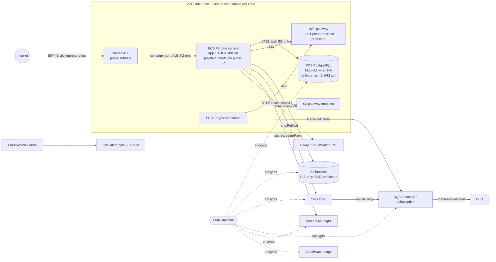

# AWS provider implementation guide

Status: **implemented and mock-tested; NOT tested against real AWS.** Every behaviour below was
checked with `tofu test` and `terraform test` using `mock_provider "aws"`. Mocks prove wiring,
policy contents and contract shape. They do not prove that AWS accepts the configuration or
behaves as described. Treat the first real deployment as a validation exercise.

Tested with: OpenTofu 1.13.9 and Terraform 1.15.6, `hashicorp/aws` **6.73.0**, `hashicorp/random`
**3.9.1**, and the ADOT collector image `public.ecr.aws/aws-observability/aws-otel-collector:v0.51.0`.
Modules declare `aws ~> 6.73`, `random ~> 3.9` and `required_version >= 1.10`. No registry modules
are used: every resource is an official `hashicorp/aws` resource, so there are no extra downloads
and nothing to audit.

## Layout

| Path | Purpose |
|---|---|
| `infra/providers/aws/platform` | Composition implementing `infra/contract` (variables copied verbatim, contract outputs) |
| `infra/modules/aws/naming` | `<project>-<environment>-<name>` with sha1 truncation (pure, no provider) |
| `infra/modules/aws/kms` | One CMK per environment (when `security.customer_managed_keys`) |
| `infra/modules/aws/network` | VPC, subnets, IGW, NAT, routes, S3 gateway endpoint, flow logs |
| `infra/modules/aws/container-service` | ECS cluster, Fargate services, IAM, shared ALB, autoscaling, alarms |
| `infra/modules/aws/postgres` | RDS for PostgreSQL |
| `infra/modules/aws/object-storage` | S3 buckets |
| `infra/modules/aws/messaging` | SNS topics plus one SQS queue (and optional DLQ) per subscription |
| `infra/modules/aws/secrets` | Secrets Manager containers (no values) |
| `infra/modules/aws/observability` | Service log groups, KMS-encrypted alert topic (environment CMK, or a dedicated alert key without one), e-mail subscription |
| `infra/bootstrap/aws/state-backend` | S3 state bucket and `backend_config` |

The composition does **not** configure `provider "aws"`. The rendered root must configure it
with `region = <spec region>` and `allowed_account_ids = [<cloud.account>]`. A postcondition on
`data.aws_region` rejects a region mismatch. The renderer passes the contents of
`extensions.aws` as `var.extensions`.

## Architecture



## Service choices

| Capability | AWS service | Why |
|---|---|---|
| containerized compute | ECS on Fargate, behind one shared ALB per environment | No nodes to manage; the closest to Cloud Run while keeping a long-running service model. One ALB keeps the fixed cost to a single load balancer. |
| database | RDS for PostgreSQL (single instance; Multi-AZ when HA) | Cheapest managed PostgreSQL with PostGIS and IAM authentication. Aurora costs more and differs operationally. |
| storage | S3 | Native object store. |
| messaging | SNS topic plus one SQS queue per subscription | Matches the publish/subscribe model with a durable queue per subscription (see differences below). |
| secrets | Secrets Manager | Native ECS injection (`valueFrom`) and KMS integration. |
| observability | CloudWatch Logs, CloudWatch alarms, X-Ray through an ADOT sidecar | Native, and the ADOT collector receives OTLP. |
| state | S3 with native lock files (`use_lockfile`) | No DynamoDB table needed (OpenTofu ≥ 1.10, Terraform ≥ 1.11). |

**SNS + SQS compared with a Pub/Sub topic and subscription.** Both deliver at least once, so
consumers must be idempotent. The ack deadline maps to the SQS visibility timeout: a message not
deleted within `ack_deadline_seconds` becomes visible again. Messages are not ordered (FIFO topics
and queues are not used). Retention is per subscription queue (`retention_hours` →
`message_retention_seconds`); SNS itself stores nothing. `max_delivery_attempts` maps to the DLQ
`maxReceiveCount`, and the DLQ keeps messages for 14 days. Messages are delivered raw (no SNS
envelope).

## Feature matrix

All entries are implemented and mock-tested, and none has been tested against real AWS. "Partial"
means part of the portable semantics is missing on AWS.

| Feature | Status | Note |
|---|---|---|
| compute.public_https | implemented, mock-tested | HTTPS listener (`ELBSecurityPolicy-TLS13-1-2-2021-06`) plus an HTTP→HTTPS 301 redirect when `extensions.aws.acm_certificate_arn` is set. Without a certificate: plain HTTP, rejected when protected (precondition). DNS is out of scope. |
| compute.scale_to_zero | partial | `min_instances: 0` is honoured. Queue consumers scale out from zero on SQS backlog and back to zero after 15 idle minutes. HTTP services do **not** scale up from zero (a check warns): the ALB returns 503 until scaled. |
| compute.otel_sidecar | implemented, mock-tested | ADOT collector v0.51.0. OTLP on 127.0.0.1:4317/4318 sends traces to X-Ray and metrics (EMF) to the service log group. Not verified that the collector runs with a read-only root filesystem. |
| database.high_availability | implemented, mock-tested | `multi_az = true` (synchronous standby). |
| database.postgis | partial | Extension names are checked against an allowlist. `CREATE EXTENSION` is a post-provision step (the DB is private; no SQL runs from IaC). |
| database.iam_auth | implemented, mock-tested | IAM authentication on; `rds-db:connect` for dbuser `app` only. The `app` user is created out-of-band (SQL below). |
| database.pitr | implemented, mock-tested | Inherent to RDS automated backups (`backup_retention_days` ≥ 1). `point_in_time_recovery: false` cannot disable it on RDS. |
| database.customer_managed_keys | implemented, mock-tested | CMK for storage, Performance Insights, the master-user secret and exported logs. |
| storage.versioning | implemented, mock-tested | `Enabled`, or `Suspended` when the spec says false. Noncurrent versions expire (30 days; 90 when protected). |
| storage.retention | implemented, mock-tested | Lifecycle expiration of current objects after `retention_days`. |
| storage.customer_managed_keys | implemented, mock-tested | SSE-KMS with the CMK and S3 Bucket Keys; SSE-S3 (AES256) otherwise. |
| messaging.dead_letter | implemented, mock-tested | DLQ, redrive policy, redrive-allow policy (source queue only) and a DLQ-not-empty alarm. None when attempts = 0. |
| messaging.retention | implemented, mock-tested | SQS retention per subscription (1–168 h). |
| secrets.native_injection | implemented, mock-tested | ECS `secrets[].valueFrom` = secret ARN. The execution role reads only the secrets that service references. |
| observability.logs_retention | implemented, mock-tested | Rounded up to the next CloudWatch-supported value (e.g. 45 → 60). |
| observability.alerts | implemented, mock-tested | Alert topic plus e-mail subscription (needs confirmation). The topic is always KMS-encrypted (HCF-POL-002): with `customer_managed_keys` it uses the environment CMK; without, Hermes creates one small dedicated key for the alert topic only, because CloudWatch alarms cannot publish to a topic encrypted with the AWS-managed `alias/aws/sns` key. Alarms: ALB 5xx, target 5xx, ECS CPU, RDS CPU and free storage, DLQ depth. Thresholds are fixed. |
| observability.tracing | implemented, mock-tested | X-Ray through the ADOT sidecar. |
| state.remote_backend | implemented, mock-tested | Bootstrap S3 bucket: versioned, SSE-KMS, public access blocked, TLS-only, `prevent_destroy`. |
| state.locking | implemented, mock-tested (config only) | `use_lockfile = true` in `backend_config` (S3 native locking). Legacy DynamoDB locking is available through `state.lock_table`. |
| state.client_side_encryption | implemented in the renderer (OpenTofu only) | OpenTofu `aws_kms` key provider when `state.encryption.client_side` is set and the engine is `tofu`; not available with Terraform. Not tested against real KMS. |
| identity.per_service | implemented, mock-tested | One task role and one execution role per service, granting exact ARNs derived from `access`. Trust policies carry `aws:SourceAccount`/`aws:SourceArn`. |

## What each spec field becomes

- **Naming**: `<project>-<environment>-<name>`, truncated to the AWS limit with `-<sha1[0:6]>`
  (ALB and target group 32, IAM role 64, RDS 63, SQS 76 so that `-dlq` fits, bucket base 54 plus
  `-<8 hex random_id>`). Log groups live under `/hermes/<project>/<environment>/…`.
- **Tags**: `hermes-project`, `hermes-environment`, `hermes-managed-by=hermes`,
  `hermes-component`, plus `labels`, on every taggable resource. ECS propagates service tags to tasks.
- **Network**: private subnet *i* = `cidrsubnet(cidr, 2, i)`; public subnet *i* = `cidrsubnet(cidrsubnet(cidr, 2, 3), 3, i)`
  (a /16 gives private /18 and public /21 subnets; a /20 gives /22 and /25). The default security group has no rules.
  Flow logs (all traffic) go to CloudWatch when observability is enabled.
- **Protected** (`var.protected`): one NAT gateway per zone, ALB deletion protection, HTTPS
  required, RDS deletion protection plus a final snapshot (`<id>-final`) plus retained automated
  backups, changes applied in the maintenance window, a 30-day secret recovery window, a 30-day
  KMS deletion window, and 90 days of noncurrent object versions.
- **Fargate sizes**: `cpu * 1024` CPU units. A precondition rejects invalid combinations
  (0.25 vCPU: 512/1024/2048 MiB; 0.5: 1024–4096; 1: 2048–8192; 2: 4096–16384; 4: 8192–30720, in 1 GiB steps).
- **Routing**: the first public service (in spec order) is the ALB default route. Each other
  public service matches `/<name>` and `/<name>/*`, and the prefix is **not** stripped. URLs:
  `https://<alb-dns>` and `https://<alb-dns>/<name>/` (`http://` without a certificate).
- **Task networking**: private subnets, no public IP. Ingress comes only from the ALB security
  group on the container port. Egress is TCP 443 to anywhere, plus 5432 to the database for
  services with `access.database`.
- **Containers**: read-only root filesystem with a writable `/tmp` volume, `initProcessEnabled`,
  `awslogs`, deployment circuit breaker with rollback, CPU target tracking at 60%.

### Database size mapping

| size | instance class | notes |
|---|---|---|
| small | db.t4g.small | burstable, 2 vCPU / 2 GiB |
| medium | db.m7g.large | 2 vCPU / 8 GiB |
| large | db.m7g.xlarge | 4 vCPU / 16 GiB |
| xlarge | db.m7g.2xlarge | 8 vCPU / 32 GiB |

Availability per region was **not verified**; override with `extensions.aws.db_instance_class`.
Storage is gp3, starting at `storage_gb` and autoscaling up to `max_storage_gb`.

## Extension keys (`extensions.aws`)

Unknown keys are rejected (precondition on `bindings`).

| Key | Default | Effect |
|---|---|---|
| `acm_certificate_arn` | `""` | ACM certificate (same region) for the HTTPS listener. Required for public services in protected environments. |
| `alb_ingress_cidrs` | `["0.0.0.0/0"]` | IPv4 CIDRs allowed to reach the ALB on 80/443. Public services (`public: true`) are internet-facing by default; narrow this for partner-only or internal audiences. `hermes validate` requires a non-empty list of valid IPv4 networks without host bits or duplicates. |
| `task_egress_cidrs` | `["0.0.0.0/0"]` | IPv4 CIDRs tasks may reach on TCP 443 (one egress rule per service and CIDR). Narrow it when VPC endpoints or an egress proxy carry the traffic. `hermes validate` requires a non-empty list of valid IPv4 networks without host bits or duplicates (the module validates it too). |
| `cpu_architecture` | `"X86_64"` | `X86_64` or `ARM64` (Graviton; images must support it). |
| `db_instance_class` | `""` | Overrides the size mapping. |
| `readonly_root_filesystem` | `true` | `false` lets application containers write to their root filesystem. |
| `container_health_check` | `false` | Adds an ECS health check (`wget` or `curl` against `health_check_path`; the image needs `sh` plus one of them). ALB health checks are always configured for public services. |

## Post-provision steps

1. **Confirm the alert e-mail subscription** (AWS sends a confirmation link).
2. **Set secret values** out-of-band, e.g. in the console or with the CLI from a trusted workstation.
   Hermes creates the containers only.
3. **Create the application database user and extensions.** The database is private: run this
   from inside the VPC (for example a one-off ECS task), connected as `hermes_admin` using the
   RDS-managed secret in `bindings.database.credentials_ref`:

   ```sql
   CREATE EXTENSION IF NOT EXISTS postgis;   -- for each entry in database.extensions
   CREATE USER app;
   GRANT rds_iam TO app;
   GRANT CONNECT ON DATABASE app TO app;
   GRANT USAGE, CREATE ON SCHEMA public TO app;
   ```

   Applications connect as `HERMES_DB_USER` (`app`) with an IAM auth token
   (`HERMES_DB_AUTH=iam`; generate the token with the AWS SDK for host, port, user and region)
   over TLS (`sslmode=verify-full` with the RDS CA bundle; plain connections are refused by `rds.force_ssl`).
4. **DNS**: point your certificate's host name (CNAME or alias) at the ALB DNS name.

## Cost notes (indicative us-east-1 list prices; verify with AWS pricing)

The cheapest development footprint (2 zones, single NAT, 1 small task, no public service,
small single-AZ DB) costs roughly: NAT gateway ≈ $33/month plus $0.045/GB processed;
db.t4g.small ≈ $25–30/month plus storage; Fargate 0.5 vCPU/1 GiB ≈ $17/month per always-on task;
Secrets Manager $0.40/secret/month; CloudWatch Logs per GB ingested. Adding a public service adds
the ALB at ≈ $16/month plus LCUs. `customer_managed_keys` adds $1/month per key plus requests.
Without `customer_managed_keys`, an environment with alerts (observability enabled) still gets one
dedicated KMS key for the alert topic (≈ $1/month plus requests).

A protected production environment with 3 zones adds 3 NAT gateways (≈ $100/month before data),
Multi-AZ (roughly doubles database cost), larger instance classes, Container Insights and
Enhanced Monitoring (per metric), and longer log retention.

The main cost drivers are NAT gateways (per zone and per GB), database HA and size, the ALB, and
always-on task count. `network.nat: false` removes the NAT cost, but tasks then have no egress
(see limitations).

## Known limitations

- Nothing has been deployed to real AWS. KMS key-policy statements for SNS→SQS and
  CloudWatch→SNS, the ADOT read-only root filesystem, queue-backlog scaling and Database Insights
  behaviour are unverified. The CMK policy is scoped (mock-tested): CloudWatch Logs only for
  `log-group:/hermes/<project>/<env>/*` and `/aws/rds/instance/<db identifier>/*` (encryption-context
  condition); SNS only with `aws:SourceAccount` and `aws:SourceArn` of this environment's topics (no SNS
  statement without topics); CloudWatch only with `aws:SourceAccount` and `aws:SourceArn`
  `arn:<partition>:cloudwatch:<region>:<account>:alarm:*`. If CloudWatch does not send these source keys
  on the KMS call, alarm e-mails to the encrypted alert topic fail; that path has not been tested against real AWS.
  The same applies to the dedicated alert-topic key created without `customer_managed_keys` (account root,
  CloudWatch with `aws:SourceAccount` + alarm `aws:SourceArn`, SNS with `aws:SourceAccount` + the alert topic ARN).
- `network.nat: false` creates no VPC interface endpoints: tasks cannot pull non-ECR images or reach
  AWS APIs (a check warns).
- No service-to-service discovery (ECS Service Connect / Cloud Map): private services have URL `""`.
- Path-routed services receive the `/<name>` prefix. There is no host-based routing and no DNS management.
- Task egress is limited to TCP 443 (plus 5432 to the database). Other outbound ports need a module change.
- **Residual exfiltration risk (accepted by default).** By default tasks may open HTTPS connections to
  any address (`task_egress_cidrs = ["0.0.0.0/0"]`), because AWS APIs, registries and external APIs are not
  enumerable as CIDRs. A compromised task can send data to any HTTPS endpoint on the internet. Mitigations:
  (1) add VPC interface/gateway endpoints for the AWS APIs the services use (ECR, S3, Secrets Manager, SQS,
  SNS, CloudWatch Logs, STS; endpoints are not created by Hermes) and set `task_egress_cidrs` to the VPC
  CIDR; (2) send the remaining traffic through an egress proxy or AWS Network Firewall with a domain
  allowlist, and set `task_egress_cidrs` to the proxy's subnet; (3) the IAM task roles stay least-privilege,
  so stolen task credentials cannot read other services' data. Security-group rules cannot filter by
  hostname. Status of `task_egress_cidrs`: *implemented, mock-tested; not tested against a real cloud*.
- ALB ingress defaults to `0.0.0.0/0` on 80/443 for public services (by spec). It is narrowed with
  `alb_ingress_cidrs`.
- Not implemented: ALB access logs, WAF, S3 server access logs, private registries other than ECR
  (`repositoryCredentials`), cross-account ECR, Fargate Spot.
- IAM role names are account-global: the same project and environment in two regions of one account collide.
- The spec topic name `hermes-alerts` is reserved (the alert topic uses it).
- The final snapshot name `<id>-final` is static: delete or rename an old one before recreating and destroying again.
- Only the `aws` partition is exercised. The China and GovCloud principals and endpoints are not verified.
- Alarm thresholds are fixed (5xx ≥ 10 per 5 min, CPU > 85%/80%, free storage < 10%).
