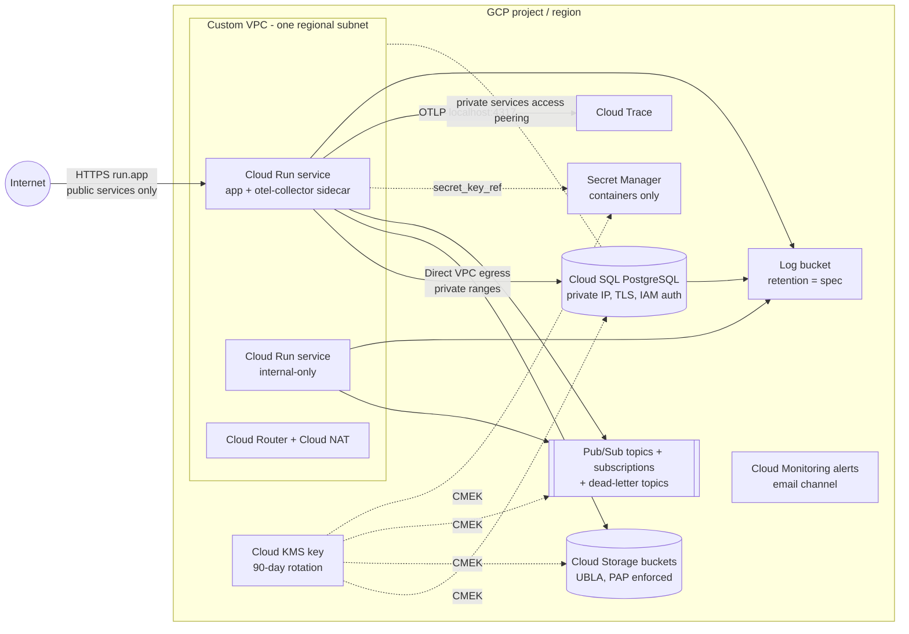

# GCP provider implementation guide

This guide covers the Google Cloud implementation of the Hermes provider composition contract
(`infra/contract/`, v1alpha1): what it creates, why, how secure it is by default, what it costs,
and what is and is not verified.

> **Verification level.** Every statement marked *mock-tested* was verified only with
> `tofu test` and mock providers. Mock tests prove wiring, contract shape and configuration
> values. They do **not** prove real-cloud behaviour (API acceptance, IAM propagation,
> quotas, org policies). Nothing in this implementation has been applied to a real Google
> Cloud project yet.

## Layout

| Path | Purpose |
|---|---|
| `infra/providers/gcp/platform` | Composition implementing the contract (variables copied verbatim) |
| `infra/modules/gcp/naming` | Pure naming and label functions (no providers) |
| `infra/modules/gcp/network` | Custom VPC, subnet, Cloud Router/NAT, private services access, firewall |
| `infra/modules/gcp/kms` | Key ring, crypto key, service-agent grants |
| `infra/modules/gcp/container-service` | One Cloud Run v2 service (+ optional OpenTelemetry Collector sidecar) |
| `infra/modules/gcp/postgres` | Cloud SQL for PostgreSQL, app database, IAM database users |
| `infra/modules/gcp/object-storage` | Cloud Storage buckets |
| `infra/modules/gcp/messaging` | Pub/Sub topics, subscriptions, dead-letter topics |
| `infra/modules/gcp/secrets` | Secret Manager secret containers (no values) |
| `infra/modules/gcp/observability` | Log bucket + sink + `_Default` exclusion, alerting |
| `infra/bootstrap/gcp/state-backend` | GCS remote-state bucket |

Providers: `hashicorp/google ~> 8.12`, `hashicorp/random ~> 3.9`, and `hashicorp/google-beta ~> 8.12`.
These were tested with **google 8.12.0, google-beta 8.12.0 and random 3.9.1** on OpenTofu 1.13.9 and
Terraform 1.15.6. `google-beta` is used for exactly one resource type,
`google_project_service_identity`. It creates the Cloud SQL and Secret Manager service agents that CMEK
needs. That resource is still beta-only in v8.12, and without it CMEK for the database and secrets
would fail on a fresh project. The rendered root module must configure **both** `google` and
`google-beta` with the same project and region.

No registry modules are used. Official provider resources only.

## Architecture



### Service choices

| Capability | GCP service | Why |
|---|---|---|
| network | Custom-mode VPC, one regional subnet | GCP subnets are regional (they span every zone), so no per-zone subnets are needed |
| containerized compute | Cloud Run v2 services | Serverless containers. HTTPS, autoscaling and scale-to-zero are built in, with no cluster or load balancer to run |
| database | Cloud SQL for PostgreSQL, Enterprise edition, custom tiers | Managed PostgreSQL with IAM authentication, PITR and regional HA |
| storage | Cloud Storage (regional, STANDARD) | Native object storage |
| messaging | Pub/Sub topics with pull subscriptions | Native publish/subscribe with a durable queue per subscription |
| secrets | Secret Manager (user-managed regional replica) | Native, injected into Cloud Run without plaintext |
| observability | Cloud Logging bucket and sink, Cloud Monitoring, Cloud Trace | Native. OTLP is exported by an OpenTelemetry Collector sidecar |

## Address plan and network

`network.cidr` (for example `10.20.0.0/16`) is split as follows:

| Range | Use |
|---|---|
| first half (`/17` of a `/16`) | subnet. Cloud Run Direct VPC egress takes instance IPs from it |
| third quarter (`/18`) | private services access range (Cloud SQL private IP) |
| fourth quarter | reserved (for example, a future proxy-only subnet) |

- `network.zones` has **no effect** on GCP. Subnets, Cloud NAT and Cloud Run are regional, and
  Cloud SQL HA picks its own standby zone.
- `network.nat = true` creates a Cloud Router and Cloud NAT for the subnet. Cloud NAT is a
  regional, software-defined service, so it needs no per-zone HA. With the default
  `vpc_egress = private-ranges-only`, Cloud Run reaches the internet through Google's own egress,
  not through NAT. NAT carries Cloud Run traffic only with `vpc_egress = all-traffic`.
- Firewall: VPC networks have an implied *deny all ingress* and *allow all egress* rule. The module
  adds an explicit deny-all-ingress rule (priority 65534, logged when observability is on) and
  **no allow rules**. Cloud Run ingress arrives through Google's front end, not the VPC, and Cloud SQL
  lives in the peered producer network.
- Private Google Access is on for the subnet. VPC flow logs (5-minute aggregation, 50% sampling) and
  Cloud NAT error logs are on when `observability.enabled`.

## Identity and least privilege

Each service gets its own service account (`<project>-<environment>-<service>`, hash-truncated to 30
characters). Grants come only from `access`:

| Spec | Grant | Scope |
|---|---|---|
| `buckets: {x: read}` | `roles/storage.objectViewer` | bucket `x` only |
| `buckets: {x: read-write}` | `roles/storage.objectUser` | bucket `x` only |
| `publish: [t]` | `roles/pubsub.publisher` | topic `t` only |
| `consume: [s]` | `roles/pubsub.subscriber` | subscription `s` only |
| `secret_env` value `n` | `roles/secretmanager.secretAccessor` | secret `n` only |
| `database: true` | `roles/cloudsql.client` + `roles/cloudsql.instanceUser` | project-level with an **IAM condition** limited to this environment's instance (Cloud SQL has no instance-level IAM) |
| observability on | `roles/logging.logWriter` (+ `monitoring.metricWriter` when metrics, `cloudtrace.agent` when tracing) | project (these roles cannot be scoped lower) |

Public services get `roles/run.invoker` for `allUsers` (`INGRESS_TRAFFIC_ALL`). Private services are
`INGRESS_TRAFFIC_INTERNAL_ONLY` and get no public invoker. An organization policy such as Domain
Restricted Sharing can block `allUsers` bindings. Public services then need an org-policy
exception.

Service agents get `roles/cloudkms.cryptoKeyEncrypterDecrypter` on the environment key only when
`customer_managed_keys` is on. The Pub/Sub service agent gets publisher on each dead-letter topic and
subscriber on each source subscription.

## Feature matrix

| Feature | Status | Note |
|---|---|---|
| compute.public_https | implemented & mock-tested; not tested on real cloud | `run.app` HTTPS URL with Google-managed TLS. Custom domains are not implemented (dns is reserved) |
| compute.scale_to_zero | implemented & mock-tested; not tested on real cloud | `min_instances: 0` sets `min_instance_count = 0` |
| compute.otel_sidecar | implemented & mock-tested; not tested on real cloud | OpenTelemetry Collector contrib `0.130.0` (overridable). Config is passed through an env var (`--config=env:OTELCOL_CONFIG`). The image tag and sidecar sizing are not verified on Cloud Run |
| database.high_availability | implemented & mock-tested; not tested on real cloud | `availability_type = REGIONAL` |
| database.postgis | partial | Cloud SQL ships PostGIS. Run `CREATE EXTENSION postgis;` after provisioning (Terraform cannot run SQL) |
| database.iam_auth | implemented & mock-tested; not tested on real cloud | `cloudsql.iam_authentication=on`, one `CLOUD_IAM_SERVICE_ACCOUNT` user per service, `HERMES_DB_AUTH=iam`. Database GRANTs are post-provision |
| database.pitr | implemented & mock-tested; not tested on real cloud | PITR plus `transaction_log_retention_days = min(7, backup_retention_days)` |
| database.customer_managed_keys | implemented & mock-tested; not tested on real cloud | `encryption_key_name`. The Cloud SQL service agent comes from `google_project_service_identity` (google-beta) |
| storage.versioning | implemented & mock-tested; not tested on real cloud | noncurrent versions deleted after 30 days (90 when protected) |
| storage.retention | implemented & mock-tested; not tested on real cloud | lifecycle `Delete` at `age = retention_days` on live objects |
| storage.customer_managed_keys | implemented & mock-tested; not tested on real cloud | default bucket key. The GCS agent is granted on the key |
| messaging.dead_letter | implemented & mock-tested; not tested on real cloud | dead-letter topic + retaining subscription + agent IAM when `max_delivery_attempts > 0`. None when 0 |
| messaging.retention | implemented & mock-tested; not tested on real cloud | topic and subscription `message_retention_duration = retention_hours`. Persistence limited to the region |
| secrets.native_injection | implemented & mock-tested; not tested on real cloud | Cloud Run `secret_key_ref` (`latest`). Values are never in state |
| observability.logs_retention | implemented & mock-tested; not tested on real cloud | dedicated regional log bucket (`retention_days`) + sink + `_Default` exclusion of the same filter |
| observability.alerts | implemented & mock-tested; not tested on real cloud | email channel, per-service Cloud Run 5xx alert, Cloud SQL CPU > 80% and disk > 85% |
| observability.tracing | implemented & mock-tested; not tested on real cloud | collector sidecar exports to Cloud Trace (and metrics to Cloud Monitoring) |
| state.remote_backend | implemented & mock-tested; not tested on real cloud | `infra/bootstrap/gcp/state-backend` |
| state.locking | implemented (engine-native) | the `gcs` backend locks natively. No extra resources. Not tested here |
| state.client_side_encryption | implemented in the renderer (OpenTofu only) | OpenTofu `gcp_kms` key provider when `state.encryption.client_side` is set and the engine is `tofu`; not available with Terraform. Not tested against real Cloud KMS |
| identity.per_service | implemented & mock-tested; not tested on real cloud | one service account per service, resource-scoped grants |

CMEK coverage is **partial overall**. Cloud SQL, Cloud Storage, Pub/Sub and Secret Manager use the
key. Cloud Run (CMEK there needs Artifact Registry images) and the Cloud Logging bucket stay
Google-managed.

## Size mappings

| `database.size` | Cloud SQL tier (Enterprise) |
|---|---|
| small | `db-custom-1-3840` (1 vCPU, 3.75 GiB) |
| medium | `db-custom-2-7680` (2 vCPU, 7.5 GiB) |
| large | `db-custom-4-15360` (4 vCPU, 15 GiB) |
| xlarge | `db-custom-8-30720` (8 vCPU, 30 GiB) |

Cloud Run CPU and memory are **rounded up** to valid Cloud Run combinations:

| Rule | Effect |
|---|---|
| CPU below 1 forces concurrency 1 and other restrictions | `0.25` and `0.5` become **1 vCPU** |
| CPU values are 1, 2, 4, 6, 8 | rounded up to the next value |
| memory > 4 / 8 / 16 / 24 GiB needs ≥ 2 / 4 / 6 / 8 vCPU | CPU is raised |
| 4 vCPU needs ≥ 2 GiB, 6+ vCPU needs ≥ 4 GiB | memory is raised |

The collector sidecar adds 0.5 vCPU and 512 MiB per instance. CPU is request-based (`cpu_idle`)
unless the sidecar runs. The sidecar exports in the background, so it needs CPU between requests.

## Extension keys (`extensions.gcp`)

| Key | Values | Default | Effect |
|---|---|---|---|
| `vpc_egress` | `private-ranges-only`, `all-traffic` | `private-ranges-only` | Cloud Run Direct VPC egress mode. `all-traffic` sends all egress through the VPC (Cloud NAT gives it a stable regional egress). With `nat: false` there is then no internet egress |
| `otel_collector_image` | container image | `otel/opentelemetry-collector-contrib:0.130.0` | Collector sidecar image. It must include the `otlp` receiver, `googlecloud` exporter, `resourcedetection`, `memory_limiter` and `batch` processors, and the `env:` config provider. Pin your own (for example, mirrored into Artifact Registry) |

Unknown keys are rejected (`terraform_data.spec_guard`).

## Naming

`<project>-<environment>-<name>`, hash-truncated (`-` plus 6 hex characters of sha1 of the full
name) to each limit: Cloud Run 49, service account 30, Cloud SQL / network / KMS 63, Pub/Sub and
secrets 255. Buckets, the key ring and the log bucket add a stable `random_id` suffix. Bucket names
must be globally unique, and key rings and log buckets cannot be reused after deletion. The Cloud SQL
instance has its own suffix, which is regenerated when a change forces replacement (Cloud SQL blocks
name reuse for about a week). Projects starting with `goog` or containing `google` are rejected,
because Cloud Storage and Pub/Sub refuse such names.

Labels on every labelable resource: `hermes-project`, `hermes-environment`,
`hermes-managed-by=hermes`, `hermes-component`, plus `project.labels`, sanitized to GCP rules
(lowercase `[a-z0-9_-]`, ≤ 63 characters). VPC networks, subnets, routers, firewalls, service
accounts and key rings do not support labels.

## Protected environments (`protected = true`)

- Cloud Run `deletion_protection` is on, and Cloud SQL deletion protection is forced on (both the
  Terraform argument and `deletion_protection_enabled`).
- Destroyed KMS key versions stay restorable for 90 days (30 otherwise). Destroyed secret versions
  stay recoverable for 30 days (7 otherwise). Noncurrent object versions are kept 90 days (30 otherwise).
- Buckets are never force-destroyed in any environment.
- Not implemented: a final Cloud SQL backup on deletion. Automated backups are deleted with the
  instance, so deletion protection is the safeguard.

## Cost notes (relative; verify with the Google Cloud pricing calculator)

Cheapest dev footprint: `nat: false`, `high_availability: false`, `size: small`, `min_instances: 0`,
`tracing: false` (no sidecar, request-based CPU), short `log_retention_days`, and no `alert_email`
(alerting itself is cheap).

Main cost drivers in a protected production environment:

1. **Cloud SQL HA**: `REGIONAL` roughly doubles instance cost. Tier and SSD size scale it further.
2. **Always-on Cloud Run**: `min_instances > 0`, and the collector sidecar, which switches to
   instance-based billing and adds 0.5 vCPU per instance.
3. **Cloud NAT**: per-gateway hourly charge plus per-GB processing.
4. **Logging volume**: ingestion is paid once (the `_Default` exclusion prevents double storage).
   Flow logs and Cloud SQL connection logs add volume.
5. KMS, Secret Manager and Pub/Sub are usage-priced and usually small.

There is **no load balancer cost**. Cloud Run serves HTTPS directly.

## Prerequisites

- The project exists, with `serviceusage.googleapis.com` and `cloudresourcemanager.googleapis.com`
  enabled. The composition enables every other API it needs (`disable_on_destroy = false`).
- The deploying identity needs, roughly: Service Usage Admin, Compute Network Admin, Compute Security
  Admin, Service Networking Admin, Cloud SQL Admin, Cloud Run Admin, Service Account Admin plus
  Service Account User (actAs on the runtime accounts), Storage Admin, Pub/Sub Admin, Secret Manager
  Admin, Cloud KMS Admin, Logging Config Writer, Monitoring Alert Policy and Notification Channel
  Editor, and Project IAM Admin (for the conditional Cloud SQL and telemetry-writer bindings). The
  security workstream owns `infra/bootstrap/gcp/ci-identity`.

## Post-provision steps

1. **Secret values**: `gcloud secrets versions add <native-secret-id> --data-file=-` for each
   name in `bindings.secrets` (values never pass through Hermes or state).
2. **Database administration**: set the built-in `postgres` password out-of-band
   (`gcloud sql users set-password postgres --instance=<instance_id> --prompt-for-password`) and
   connect through the Cloud SQL Auth Proxy (connection name `<project_id>:<region>:<instance_id>`).
3. **Extensions**: `CREATE EXTENSION IF NOT EXISTS postgis;` (and any other entry in
   `database.extensions`) in database `app`.
4. **Grants for IAM users** (one per service, see `HERMES_DB_USER`), for example:
   ```sql
   GRANT CONNECT ON DATABASE app TO "contract-full-staging-api@<project_id>.iam";
   GRANT USAGE, CREATE ON SCHEMA public TO "contract-full-staging-api@<project_id>.iam";
   ```
5. **Application connection**: use a Cloud SQL connector with automatic IAM authentication, or
   connect to `HERMES_DB_HOST:5432` with TLS (`sslmode=require`), passing an OAuth access token from
   the metadata server as the password.

## Tests

| Where | What |
|---|---|
| `platform/tests/contract.tftest.hcl` | GCP mock header plus the canonical contract runs (verbatim) |
| `platform/tests/gcp_wiring.tftest.hcl` | least privilege (the worker cannot read buckets, api publishes only to telemetry), CMEK grants, HA, deletion protection, ingress, dead-letter, binding env, protected/lean variant |
| `platform/tests/gcp_guards.tftest.hcl` | spec cross-check errors (unknown extension, bad refs, reserved env prefixes, duplicate subscriptions, `goog` prefix) |
| `modules/gcp/*/tests` | naming (no providers), Cloud Run rounding/ingress/sidecar, bucket security/lifecycle, Pub/Sub dead-letter wiring, Cloud SQL security, network address plan, secret residency/CMEK, log routing and alerts |
| `bootstrap/gcp/state-backend/tests` | plan-only (the bucket has `prevent_destroy`) |

Static analysis: `tofu fmt -check` is clean. `tflint --recursive` (bundled terraform ruleset 0.17.0)
reports 0 findings. The google tflint ruleset was not installed. `trivy config` is clean, with four
justified inline ignores: flow logs follow `observability.enabled`, the deny-all firewall rule is a
false positive, and the state bucket's CMEK is optional. checkov was not installed. Its intended
skips are already inline (`CKV_GCP_62`, `CKV_GCP_82`, `CKV_GCP_102`), but they have not been run.

Mock caveats: the project id comes from `data.google_client_config` (mocked). The network id has a
realistic mock default because the provider validates `private_network` at plan time. Every mocked
service account gets the same random email.

## Known limitations

- Cloud SQL flags (mock-tested): `cloudsql.iam_authentication`, `cloudsql.enable_pgaudit`, `log_checkpoints`,
  `log_connections`, `log_disconnections`, `log_duration`, `log_hostname`, `log_lock_waits` on;
  `log_min_error_statement = error`, `log_min_messages = warning`, `log_statement = ddl`, `log_temp_files = 0`,
  `log_min_duration_statement = -1`. Statement text is not logged, but `log_duration` writes one log line per
  statement and `log_hostname` does a reverse DNS lookup per connection, which adds Cloud Logging volume and
  connection latency on busy instances. pgAudit is only allowed by the flag: run `CREATE EXTENSION pgaudit;` and
  set `pgaudit.log` after provisioning to record audit events.
- Not applied to a real project. Org policies (Domain Restricted Sharing, CMEK-required,
  resource-location) may need adjustment.
- Service-to-service calls to internal-only Cloud Run services need egress through the VPC
  (`vpc_egress: all-traffic`) plus private DNS for `run.app`. This is not automated, so internal
  services expose `url = ""`.
- `bindings.database.user` is the IAM user only when exactly one service has database access,
  otherwise `""` (each service has its own user in `service_environment`).
- Cloud SQL backups use Google's default (multi-region) location.
- Topic retention bills storage for the retained period (it enables replay).
- No Cloud Armor, custom domains, Binary Authorization or VPC Service Controls.
