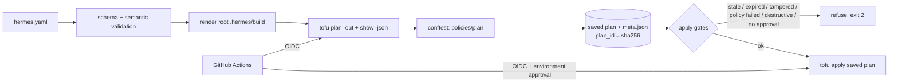

# Security architecture

How Hermes protects the estates it deploys and migrates, and where each control lives. The
threat analysis is in [threat-model.md](threat-model.md); identities are in
[iam-strategy.md](iam-strategy.md).

| Status labels | |
|---|---|
| **verified** | implemented and verified by tests in this repository (command named) |
| **mock-tested** | implemented; verified with mock providers or fakes, not against a real cloud |
| **designed** | described here, not implemented |

## 1. Principles

1. **The engine does the work; Hermes adds gates.** OpenTofu/Terraform plans and applies.
   Hermes renders a root module, saves the plan, evaluates it, and refuses unsafe applies.
2. **Fail closed.** Unknown plan actions count as replacements, a missing policy tool is an error
   in protected environments, unknown policy inputs produce warnings (never silent passes), CI
   scans run in strict mode (a missing scanner fails the job).
3. **No secrets in the system.** No secret values in specs, state, plans, outputs, inventories,
   fixtures, logs or CI. Secret containers are created by IaC; values are set out-of-band.
4. **Short-lived, federated identity everywhere.** Humans use SSO, CI uses OIDC, workloads use
   per-service identities, discovery uses an ExternalId-scoped read-only role.
5. **Defence in depth on the HCL.** Module defaults are secure, Rego policies check the plan,
   static scanners check the code, and reviewers check the diff.

## 2. Control map

| Control | Where | Status |
|---|---|---|
| Spec validation (unknown fields, protected-environment rules, `:latest` images refused in protected envs) | `internal/config`, `schemas/` | verified (`make test`) |
| Saved-plan apply: stale render digest, 24 h expiry, plan-file hash, policy result, `--allow-destructive`, `--approve <≥8-char plan-id prefix>`, `--confirm-environment` for protected destroys, history log | `internal/execution/gates.go` | verified (`go test ./internal/execution/`) with a fake engine |
| Plan policies HCF-POL-000…011 (public storage, encryption, DB exposure, public ingress, IAM wildcards, trust policies, deletion protection, backups, tags, secret material, destructive warnings) | `policies/plan`, run by `internal/policy` | verified on synthetic plans and on plans derived from the compositions with mock providers (`make policy-test`, 41 tests, 2026-11-21); not evaluated on real-cloud plans |
| Read-only discovery guard (first initialize middleware; refuses non-read and secret-read operations before signing; registry allowlist) | `internal/inventory/aws/guard.go` | verified (`go test ./internal/inventory/...`, httptest) |
| Secure module defaults (encryption, TLS-only buckets, private databases, deletion protection in protected envs, least-privilege per-service identities, log retention) | `infra/modules/*` | mock-tested (`make tf-test`) |
| CI federation (no keys), plan/apply separation, per-environment apply identities | `infra/bootstrap/*/ci-identity`, `.github/workflows/integration.yml` | mock-tested; workflow not run against a real cloud |
| Static scanning: gitleaks, trivy config, checkov, tflint, workflow SHA pins, forbidden terms | `scripts/security-scan.sh`, `.github/workflows/security.yml` | verified locally (see the security workstream report); CI not yet run |
| Client-side state encryption (OpenTofu, `aws_kms`/`gcp_kms`) | renderer | see [state-security.md](state-security.md) |

## 3. Policy as code

The Rego rules are the only automated guardrail that works the same way on all three providers.
That matters most for Alibaba Cloud, which has no TFLint ruleset, no Trivy checks and about 43
Checkov checks ([open-source landscape §7](../research/open-source-landscape.md)). Details, data
inputs and exceptions: [policies/README.md](../../policies/README.md).

- `hermes plan` passes `data.hermes.protected`, `protected_environments`, project, environment and
  provider to Conftest with `--data`. Protected environments also follow the
  `hermes-environment` tag/label and the `protected` value the root passes to the composition.
- Exceptions are per resource address, per rule, need a reason and expire. The CLI does not yet
  accept an exceptions file (**designed**; requested from the platform workstream).
- The policies see only what the plan shows. Values unknown until apply produce warnings.
- `--policy-dir` currently **replaces** the embedded bundle. Treat a custom directory as a
  privileged change (code review), and prefer adding rules over replacing them.

## 4. Supply chain

| Risk | Control | Status |
|---|---|---|
| A moved Git tag runs different code in CI (as in the March 2026 `trivy-action` compromise, CVE-2026-33634) | Every action is pinned to a full commit SHA with a version comment; `scripts/security-scan.sh` (`workflow-pins`) fails on any unpinned `uses:` | verified locally |
| A replaced release binary | Trivy, gitleaks and conftest are installed by `scripts/ci/install-tools.sh` with a SHA-256 recorded in the repository, not the release's own checksum file; trivy runs with `--skip-check-update` (embedded checks only) | implemented; runs only in CI |
| A freshly published malicious version | Dependabot with a 7-day cooldown; versions chosen manually are at least 7 days old | configured |
| Provider plugins | Registry signatures verified by the engine; exact pins in rendered roots, `~>` in modules. Lock files are gitignored, so hashes are trusted on first use per machine | partial (see threat model) |
| TFLint rulesets | Exact versions; `tflint --init` verifies official ruleset signatures | configured |
| checkov / moto from PyPI | Exact version pins, no hash pinning | partial |
| gitleaks-action licence terms for organisations | The gitleaks binary is used instead | n/a |

## 5. Data classification

| Data | Sensitivity | Handling |
|---|---|---|
| Secret values | secret | never in Hermes; out-of-band only |
| State files | confidential: full resource attributes, endpoints, IAM bindings, sometimes provider-generated secrets | encrypted remote backends, versioning, least-privilege access ([state-security.md](state-security.md)) |
| Saved plans (`plan.tfplan`, `plan.json`) | confidential: include full planned state and sensitive values in clear text | `.hermes/plans/` with 0700/0600 permissions; uploaded only by an `integration.yml` apply run, as a 1-day artifact for the approved apply job (private repositories only) |
| Inventories, assessments, migration plans | confidential: a map of an estate (accounts, networks, trust relationships) | keep out of Git and tickets; `--redact` replaces account ids |
| Policy reports, history, audit logs | internal | no values by design; hook output may contain anything (see threat model) |
| Specs (`hermes.yaml`) | internal | secret names only |

## 6. Network posture of the compositions

- Databases have private addresses only; HCF-POL-003 denies public endpoints.
- Public services are the only internet-facing entry points (ALB on AWS, Cloud Run on GCP, SAE
  internet SLB on Alibaba) and serve HTTPS where a certificate is configured; protected
  environments require one on AWS and Alibaba.
- AWS tasks may egress on TCP 443 to any address (AWS APIs, registries, external APIs). This is
  an exfiltration path; restrict it with VPC endpoints and an egress proxy or firewall when the
  workload allows.

## 7. Operational safety

Device and vehicle safety must never depend on cloud availability or on a Hermes deployment
succeeding. Hermes manages the cloud side only; edge devices must fail safe when the cloud is
unreachable ([disaster recovery strategy](../disaster-recovery/strategy.md)).
