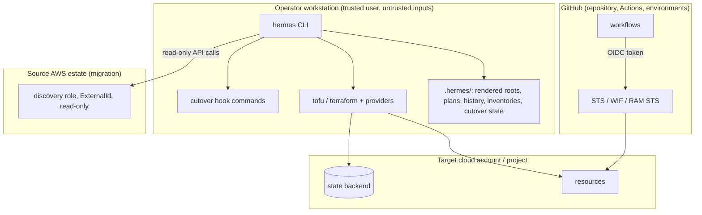

# Threat model

STRIDE analysis of Hermes Cloud Foundation (v1alpha1), reviewed 2026-11-20. It covers the CLI and
everything it renders, executes, reads and writes, the CI/CD path, and the supply chain. Control
locations are in [security-architecture.md](security-architecture.md).

## 1. Assets and trust boundaries

Assets, most sensitive first: cloud estates (production data, availability), deploy identities
(CI apply roles, operator SSO sessions), state files, saved plans, inventories of source estates,
the policy bundle, and the repository with its workflows.

Boundaries: (1) the spec and hooks files a user supplies, (2) the workstation's `.hermes/`
directory, (3) GitHub to cloud (OIDC federation), (4) Hermes to the source estate (discovery),
(5) third-party code (engine, providers, actions, scanners).

## 2. STRIDE per component

### 2.1 CLI and the local `.hermes/` directory

| | Threat | Mitigation | Residual |
|---|---|---|---|
| S | Another local user swaps a saved plan | plan dir 0700, files 0600; `plan_id` = sha256 of the plan file, checked before apply | `meta.json` is not signed: a user who can write `.hermes/` can also run the engine directly |
| T | Plan edited after review | hash check (HCF504), render digest (HCF502), 24 h expiry (HCF503) | — |
| R | "Who applied this?" | append-only `.hermes/history/<env>.jsonl` with OS user and plan id | local file; not tamper-evident; ship to central logging for production |
| I | Plans contain sensitive values in clear text | 0600, `.hermes/` gitignored; CI uploads the reviewed plan only for an apply run (1-day artifact) | backups and disk images of workstations; anyone who can download Actions artifacts within a day |
| D | — | — | — |
| E | Silent destructive apply | `--allow-destructive`, `--approve`, `--confirm-environment`; unknown actions treated as replace | an operator can pass every flag; approval is a prefix the same person reads |

### 2.2 Rendered roots and modules

| | Threat | Mitigation | Residual |
|---|---|---|---|
| T | Embedded modules modified on disk | extracted per CLI version with a digest check (`modules_digest` in plan meta); any symbolic link or special file in the extracted tree (or a symlinked modules directory) counts as a modification, because the digest covers regular files only and the engine follows links | — |
| I | Insecure configuration reaches a cloud | secure module defaults, plan policies, scanners | values unknown at plan time are not evaluated |
| E | Policy bypass | protected environments require conftest unless `--skip-policy` (recorded); `--policy-dir` only adds bundles (the embedded bundle always runs); the sha256 of every bundle and `--policy-data` file is recorded in `meta.json` and history; data files cannot override spec-derived keys (F3, fixed) | `--skip-policy` is still available (recorded); exceptions in a `--policy-data` file are only as good as their review |

### 2.3 State backends

| | Threat | Mitigation | Residual |
|---|---|---|---|
| I | State read by a broad identity (state holds endpoints, IAM graph, sometimes generated secrets) | private, encrypted buckets; plan identities read state but write only lock files; per-environment write access | AWS/GCP plan identities can read the state of every environment of the project |
| T | State overwritten or rolled back | versioning + deletion protection; apply identities write only their environment | S3 lock files are advisory |
| D | Lock never released / bucket deleted | `force-unlock` runbook; `prevent_destroy`; versioning | — |

See [state-security.md](state-security.md).

### 2.4 CI/CD and OIDC

| | Threat | Mitigation | Residual |
|---|---|---|---|
| S | A fork or another repository federates | trust pins the exact `sub` (`repo:<owner>/<repo>:…`), audience and issuer; GCP `attribute_condition` pins the repository (and optionally its numeric id); GitHub issues no OIDC token to fork PRs; HCF-POL-010 denies wildcard subjects | repository rename/re-creation: pin `repository_id` (GCP) or customise the `sub` claim template |
| S | A PR author changes a workflow and assumes the plan role | plan roles are read-only, cannot read secret values or object data, and can write only lock files | plan roles read every environment's state and (AWS ReadOnlyAccess, GCP viewer) broad metadata |
| E | Apply without a human | apply identities trust only `environment:<env>`; `integration.yml` refuses environments without required reviewers, runs only from `main`, and the approved apply job applies the reviewed saved plan artifact (sha256 = reviewed plan id), never a re-plan | a repository admin can remove protection rules; the summary shows actions and addresses, not values |
| E | Apply identity escalates (e.g. attaches AdministratorAccess) | AWS: attachable policies and PassRole targets restricted, CI roles cannot modify themselves, optional permissions boundary; GCP: Project IAM Admin conditioned to the grantable roles; Alibaba: CI roles excluded from the `<project>-*` scope and denied `ram:*` | the deploy sets are inherently broad ([iam-strategy.md](iam-strategy.md)) |
| I | Plan files leaked as artifacts | uploaded only for apply runs, 1-day retention, private repositories only; summaries show no values | anyone with artifact access during that day; job logs show resource addresses |

### 2.5 Provider modules and workload identities

| | Threat | Mitigation | Residual |
|---|---|---|---|
| E | A service reads another service's data | per-service roles / service accounts / RAM roles derived from `access` | Alibaba workload roles currently trust the whole account (see §4, F1) |
| I | Public bucket or database | no public option in the spec; HCF-POL-001/003 | — |
| I | Egress exfiltration | — | AWS tasks may reach any address on 443 |

### 2.6 Discovery role and inventory files

| | Threat | Mitigation | Residual |
|---|---|---|---|
| S | Confused deputy on the discovery role | ExternalId condition | ExternalId is not a secret; it prevents confused-deputy only |
| T | Discovery modifies the source | guard middleware refuses non-read operations before signing; registry allowlist; unit test | a bug in the guard would be serious: keep the read-only IAM policy as the second layer |
| I | Secret values collected | secret-read operations denied (`GetSecretValue`, `GetParameter*`, `GetObject`…); env vars stored as names only | Lambda `ListFunctions` returns env values in memory; they are discarded |
| I | Inventory leaks the estate map | `--redact` for account ids; inventory files written with mode 0600 | copies in tickets, chat or Git |

### 2.7 Migration hooks (command execution)

| | Threat | Mitigation | Residual |
|---|---|---|---|
| E | Arbitrary command execution | hooks run only commands the operator declared, without a shell, only with `--approve` (and `--approve-source-step` for source-touching steps) | hooks inherit the operator's environment, including cloud credentials, by design (they need them). Use narrowly scoped, short-lived credentials for the cutover window ([migration-commands.md](../migration/migration-commands.md#hermes-migrate-cutover)) |
| T | Hooks file changed after review | the dry-run records the hooks file sha256 in `state.json`; `--execute` and `--rollback` refuse a different digest (re-run the dry-run and re-approve); unit- and CLI-tested (F2, fixed) | someone who can write both the hooks file and `.hermes/migrations/` on the workstation can re-run the dry-run |
| I | Hook output with secrets persisted | hook output is streamed to the terminal only; `state.json` and `audit.jsonl` keep exit code, duration, byte count and sha256 (F2, fixed) | terminal scrollback and CI logs still show the output |

### 2.8 Supply chain

Providers, modules, actions and scanners are third-party code running with deploy rights. See
security-architecture §4. Main residual risks: lock files are not committed (provider hashes are
trusted on first use), PyPI tools are version-pinned but not hash-pinned, and the engine itself is
trusted.

### 2.9 Human approvals

Approvals are only as good as what the approver sees. The CLI prints a summary of changes and the
plan id; CI shows the change list and digest in the job summary. Approvers must read deletes and
replacements, not just counts. Use "prevent self-review" on GitHub environments.

## 3. Abuse cases

1. A contributor opens a PR that edits `integration.yml` to apply on `pull_request`: the apply
   identity trusts only `environment:<env>`, so assumption fails; branch protection plus
   CODEOWNERS on `.github/` must still catch the change.
2. A compromised dependency in a PR exfiltrates the plan role's credentials: the attacker gets
   read access to metadata and state, not secret values, object data or write access.
3. An operator runs `hermes apply --allow-destructive --approve <id>` on the wrong environment:
   the plan is bound to its environment (HCF511) and protected destroys need
   `--confirm-environment`.
4. A malicious hooks file is substituted before a cutover: `--execute` refuses it because its sha256
   differs from the one recorded at the reviewed dry-run (F2, fixed).
5. Someone edits `.hermes/policies/<version>/` to weaken policies: the extraction digest check
   refuses mismatched content; custom `--policy-dir` bundles only add rules, and their digests are
   recorded with the plan (F3, fixed).

## 4. Findings to fix (from the 2026-11-20 review)

| Id | Severity | Finding | Suggested fix |
|---|---|---|---|
| F1 | High | Alibaba workload RAM roles trust `acs:ram::<account>:root`; any account principal allowed `sts:AssumeRole` can act as any service (secrets, buckets) and the SAE binding is a manual step | **fixed (mock-tested)**: roles trust the SAE service principal `sae.aliyuncs.com` by default, or the RAM role/user ARNs in `extensions.alibaba.workload_role_trusted_principals`; the account root is rejected (Go validation and module validation) and asserted absent in module and composition tests. An RRSA (OIDC, `sub`-scoped) trust statement is *designed, not implemented* (added out-of-band); `identity.per_service` stays partial |
| F2 | Medium | Cutover hook output is persisted; hooks file not bound to the approval | **fixed (unit- and CLI-tested)**: only exit code, duration, byte count and sha256 of the output are stored; the dry-run records the hooks file sha256 and `--execute`/`--rollback` refuse a different file |
| F3 | Medium | `--policy-dir` replaces the embedded policies; policy digest not recorded | **fixed (unit- and CLI-tested)**: `--policy-dir` is additive; bundle and `--policy-data` digests are recorded in `meta.json` and history |
| F4 | Low | KMS key policy grants CloudWatch Logs for every log group, SNS for the whole account, CloudWatch without a condition | **fixed (mock-tested)**: Logs scoped to `log-group:/hermes/<project>/<env>/*` and the RDS export groups; SNS to `aws:SourceAccount` + `aws:SourceArn` of the env's topics; CloudWatch to `aws:SourceAccount` + alarms in this account/region |

## 5. Main failure scenarios

| Scenario | Effect | Recovery |
|---|---|---|
| State bucket deleted or corrupted | engine loses track of resources | restore a previous object version ([backup-and-restore.md](../disaster-recovery/backup-and-restore.md)) |
| Lock left behind by a crashed run | plans/applies blocked | verify no run is active, `tofu force-unlock <id>` |
| CI identity deleted or trust broken | no CI deploys | re-apply `infra/bootstrap/<provider>/ci-identity` with operator SSO |
| Partial apply failure | some resources created | re-plan; the engine converges; never edit state by hand without a backup |
| Provider/region outage | services down | per-tier DR ([strategy.md](../disaster-recovery/strategy.md)) |

## 6. Residual risks accepted for v1alpha1

The deploy identities are broad; approvals are human judgement; the engine and providers are
trusted; nothing has been tested against a real cloud account; scanners have weak Alibaba
coverage, so the Rego rules carry that load.
