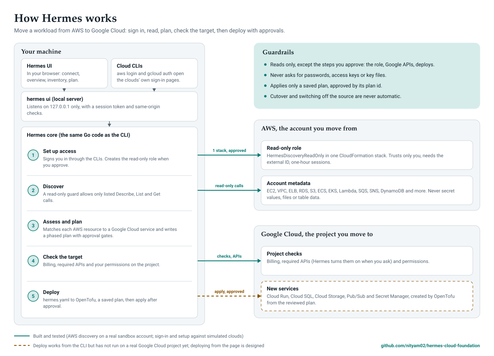

# The Hermes UI

A local web page where you connect AWS and Google Cloud, check both, run discovery, assessment and
planning, and see the results. It runs on your machine from the `hermes` binary and uses your own
cloud sign-ins. You do not need a terminal after starting it, and it never asks for a password,
access key or key file.

```bash
hermes ui            # opens the page in your browser; --open=false only prints the link
```



## The flow

The Connect page shows both clouds side by side, each with three steps. A line between them fills
in as each side connects. Both sides can run at the same time.

**From AWS**

1. **Sign in.** Hermes lists the profiles in your AWS config and checks which are signed in, so you
   can see which ones work. It picks a signed-in, non-root profile for you. *Sign in to AWS* runs the
   AWS CLI's own browser sign-in (`aws login`, or `aws sso login` for IAM Identity Center profiles); a
   new profile name creates the profile first. If no tab opens, the page shows the sign-in link (and
   the device code, for SSO). The root user is refused: AWS never lets root assume a role.
2. **Read-only role.** *Create the role* creates one CloudFormation stack, `hermes-discovery-role`,
   with your sign-in. It holds the role `HermesDiscoveryReadOnly`, which can only list and describe,
   trusts only you, and needs an external ID Hermes generates. If the stack already exists, Hermes uses
   it, and offers to point it at your sign-in or update its permissions. *Manage* lets you update or
   remove it (removing asks first). *Create it yourself instead* keeps the template, console and
   command path for people who cannot create IAM roles.
3. **Check access.** Runs by itself once the role is ready: it assumes the role, reads one region and
   lists any read calls that were denied.

**To Google Cloud**

1. **Sign in.** Hermes signs in through the Google Cloud CLI
   (`gcloud auth application-default login`). If the CLI is missing and Homebrew is installed,
   *Install the Google Cloud CLI* runs `brew install --cask gcloud-cli`; otherwise the page links to
   Google's installer. The page shows the account you signed in with.
2. **Project.** Pick a project from the list your account can see (or type its ID if listing is not
   allowed), and a region for new resources.
3. **Ready to deploy.** Runs by itself after you pick the project: project, billing, required APIs and
   your permissions. *Turn on the APIs Hermes uses* enables the missing ones through Service Usage;
   *Open billing* links to the project's billing page.

**Discover and plan.** Needs only AWS. One click runs discovery, assessment and planning as a job
with named steps; the results appear on the Overview, Inventory, Plan and Gaps pages. Files are saved
under `.hermes/ui/runs/<time>/` so the CLI can use them too.

What you connected is remembered in `.hermes/ui/connection.json` (profile, region, role ARN, external
ID, project and region; no credential), so restarting `hermes ui` picks up where you left off. A
reloaded page also reattaches to a sign-in or setup that is still running.

### What the page changes in your clouds

Everything is read-only except these, and each runs only when you press its button:

| Button | Change |
|---|---|
| Create the role, Update permissions, Trust my sign-in instead, Repair the role | creates or updates the CloudFormation stack `hermes-discovery-role` (one IAM role and its inline read-only policy) |
| Remove the role (asks first) | deletes that stack |
| Turn on the APIs Hermes uses | enables the missing Google APIs on the chosen project (free by itself) |

The stack calls use your own sign-in, not the read-only discovery client, and only ever name that stack.

## What each page shows

| Page | Shows |
|---|---|
| Connect | The three steps above |
| Overview | Portability score and how it is calculated, blockers and risks, data volume, indicative transfer cost, migration waves |
| Inventory | Every resource with where it lands on the target, fit, effort and wave; search and filters |
| Plan | The phases as a route, each step with its gate, whether it changes the source, whether it is reversible, its checks, risks and rollback |
| Gaps | Calls the read-only role could not make, and resources without a ready target |

You can also open existing documents: `hermes ui --inventory inventory.json --assessment assessment.json --plan plan.yaml`.
Add `?demo` to the address to see a synthetic sample without any cloud access.

## Security model

- **Loopback only.** The server refuses any listen address that is not `127.0.0.1`, `::1` or `localhost`.
- **Token and cookie.** The printed link carries a random 256-bit token. The server exchanges it for an
  `HttpOnly`, `SameSite=Strict` cookie and removes it from the address. Every API call needs the cookie.
- **Cross-site protection.** Every `POST` needs a custom header, a JSON content type and a same-origin
  `Origin`, so a web page on another site cannot trigger an action. Requests whose `Host` header is not
  loopback are refused (DNS rebinding).
- **No outside requests.** The page loads nothing from other sites (CSP `default-src 'self'`, system fonts).
- **No stored credentials.** Hermes never sees a password or key. Sign-ins are done by the clouds' own
  CLIs, which keep the short-lived credentials in their usual caches. Hermes runs those CLIs without a
  shell, with validated arguments, and shows only sign-in links that point at AWS or Google hosts. The
  remembered connection holds names and IDs only (the external ID is an anti-confusion value that AWS
  does not treat as secret).
- **Read-only against your clouds, except the buttons above.** The AWS reads go through the same guard as
  the CLI: an operation allowlist is enforced before any request is signed. The Google checks only read
  project metadata and call `testIamPermissions`.
- **Plan integrity.** A plan opened with `--plan` has its `plan_id` verified against its body.

## Develop the UI

The app lives in [`ui/`](../../ui) (React, TypeScript, Vite). The CLI embeds the build.

```bash
make ui-install      # npm ci, no install scripts
make ui-test         # typecheck and unit tests
make ui-build        # production build, copied to internal/uiserver/dist
make build           # CLI with the UI embedded
make ui-dev          # the built UI over pretend clouds: every flow works without any account
cd ui && npm run dev # hot reload; proxies /api to a running `hermes ui` on 127.0.0.1:8787
cd ui && npm run demo-data   # regenerate the synthetic sample from examples/migration
```

A CLI built without `make ui-build` still works; `hermes ui` then serves a short "UI is not built" page.

## Status

| | |
|---|---|
| Connect AWS and Google Cloud with live checks | implemented. The AWS check was run against a real sandbox account (role assumed, 9 resources read, a missing permission reported). The Google path is tested against a fake Google API only, because no Google credentials were available |
| Sign in from the page (`aws login`, `aws sso login`, `gcloud auth application-default login`), installing the Google Cloud CLI with Homebrew | implemented, **not tested against real cloud**: tested with fake CLIs, and the whole page was walked through against pretend clouds (`make ui-dev`) |
| Create, update and remove the read-only role stack from the page; turn on Google APIs | implemented, **not tested against real cloud**: tested with a fake CloudFormation and a fake Google API |
| Discovery, assessment and plan from the page | implemented; discovery verified on a real sandbox, the job runner tested with fakes |
| Deploy a new service from a form (spec, validation, rendered OpenTofu, plan) | designed, not implemented |
| Apply, destroy and approvals from the page | designed, not implemented |
| Migration execution (target provisioning, data movement, cutover) | designed, not implemented |
| Hosted multi-user version | not supported |

The design and the reasons are in [ADR 0016](../decisions/0016-ui-control-plane.md).
